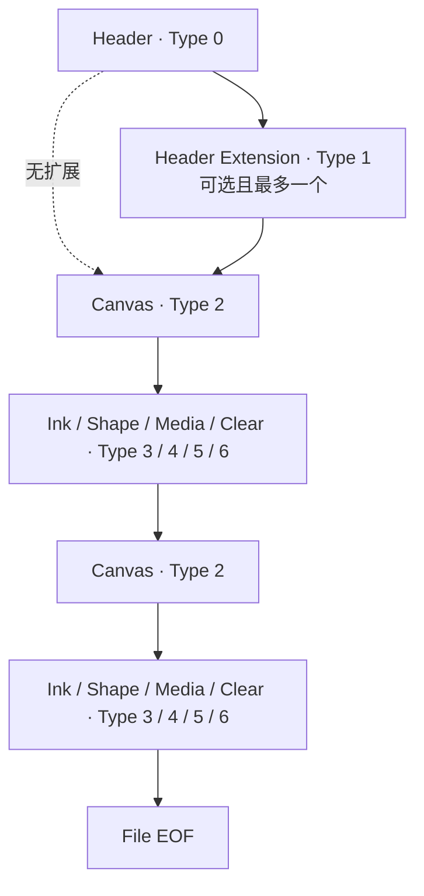

# UInk 1.0 Beta 规范（单文件存档）

> 版本：UInk 1.0 Beta（`Header.version = 10`）。
>
> 这是 version 10 规范的冻结存档，不再更新。当前版本见 https://www.inkeys.top/standard/ ，1.0 → 1.1 的变化与 1.0 勘误见 https://www.inkeys.top/standard/version.html
>
> 文中的页面链接指向网站当前页面，内容可能已经是新版本；1.0 的公开样例位于 https://www.inkeys.top/dist-standard/uink-v10/

## 目录

1. UInk 规范（/standard/intro.html）
2. 规范版本（/standard/version.html）
3. 块类型（Type ID）（/standard/type.html）
4. 增量写入（/standard/incremental.html）
5. 实现一致性与样例（/standard/conformance.html）
6. 墨迹主文件（/standard/file/main.html）
7. Header 块（/standard/blocks/header.html）
8. Header Extension 块（/standard/blocks/headerExtension.html）
9. Device 结构（/standard/blocks/device.html）
10. Canvas 块（/standard/blocks/canvas.html）
11. Clear 块（/standard/blocks/clear.html）
12. Ink 块（/standard/blocks/ink.html）
13. Shape 块（/standard/blocks/shape.html）
14. Media 块（/standard/blocks/media.html）
15. Color Map（/standard/common/color.html）

---

## UInk 规范

> 网页版：https://www.inkeys.top/standard/intro.html

UInk 规范用于解决本地绘图软件的墨迹存储与跨端预览问题。规范优先保证数据语义、内容布局和基础呈现一致；自由墨迹曲线、Marker 外形、抗锯齿以及复杂擦除效果可以因软件实现而不同。

::: tip UInk 1.0 Beta
当前规范版本号为 `10`，发布状态为 UInk 1.0 Beta，规范仍在完善。本文档定义最新的 version `10` 兼容基线并取代此前所有同版本草案；旧草案文件不属于兼容范围，读取器无须支持。
:::

[规范版本号](/standard/version.html)

### 特点

1. 一个文件可以注册多个屏幕批注、白板或 PPT Workspace，并支持父子工作区、多显示器、多页面和多图层。
2. 支持可选的[增量写入](/standard/incremental.html)，在当前文件末尾 Canvas 中追加完整内容，用于降低运行中崩溃造成的数据丢失。
3. 墨迹主文件使用连续 MessagePack 对象流，兼顾读写性能、体积和扩展性。
4. Ink、Shape、Media 与 Clear 按它们在顶层对象流中的先后顺序混合处理，并共享内容编号和撤回分组；Clear 可以保留此前内容供逐级撤回，同时把当前 Canvas 恢复为透明状态。
5. Device 与 Canvas 解耦：Device 描述显示区域，Canvas 使用逻辑像素保存内容，并可通过 `viewport` 保存平移与缩放状态。
6. 擦除、普通笔和两类荧光笔统一使用 [Ink 块](/standard/blocks/ink.html)，未知样式可以安全回退。

### 文件

#### 墨迹文件

UInk 格式由必需的墨迹主文件和可选的墨迹扩展文件组成。

::: file-tree

- filename.uink MessagePack
- filename.uink.extra ZIP
  - *.png
  - *.svg
  - *.mp3
  - *.pdf
  - ……

:::

- 墨迹主文件（`filename.uink`）使用 [MessagePack](https://msgpack.org/) 对象流，保存 Ink、Shape、Media、Clear、Canvas 和元数据。
- 墨迹扩展文件（`filename.uink.extra`）使用 ZIP 格式打包，保存由 [Media 块](/standard/blocks/media.html) 引用的图片、SVG、音视频和 PDF 等资源。

两个文件使用相同的基础文件名，其中墨迹扩展文件是可选的。`.uink` 主文件始终是当前有效内容的权威来源；资源包缺失或资源不可用时，基础 Ink/Shape 仍必须正常加载。

##### 墨迹文件的定位

- 墨迹主文件用于快速加载、基础预览和内容交换。
- 墨迹扩展文件只是资源容器，不保存内容顺序、几何或撤回信息。
- UInk 可以保存编辑与撤回所需的当前有效内容，包括被后续 Clear 隐藏但仍可撤回的旧区间；不承诺在关闭后保留 Redo 历史。

#### 墨迹扩展文件

资源路径必须是 ZIP 根目录内经过规范化的安全相对路径。媒体的 MIME、几何、播放参数、PDF 页状态和顺序全部保存在 `.uink` 主文件中，详细安全要求参见 [Media 块](/standard/blocks/media.html)。

### 第三方实现

第三方读取器和写入器必须遵守字段类型、对象顺序、容错与保存边界。实现前应先阅读[实现一致性与样例](/standard/conformance.html)，并使用公开样例验证基础互操作。

### 相关链接

- [规范版本](/standard/version.html)
- [块类型与编码](/standard/type.html)
- [实现一致性与样例](/standard/conformance.html)
- [墨迹主文件](/standard/file/main.html)
- [Device 结构](/standard/blocks/device.html)
- [Canvas 块](/standard/blocks/canvas.html)
- [Ink 块](/standard/blocks/ink.html)
- [Shape 块](/standard/blocks/shape.html)
- [Media 块](/standard/blocks/media.html)
- [Clear 块](/standard/blocks/clear.html)
- [Color Map](/standard/common/color.html)

---

## 规范版本

> 网页版：https://www.inkeys.top/standard/version.html

本页定义 `Header.version` 使用的规范版本号。

| 规范版本号 | 说明 | 状态 |
| --- | --- | --- |
| `10` | UInk 1.0 Beta | Beta，规范持续完善中 |

::: tip version 10 Beta 演进边界
version `10` 当前仍处于 Beta 草案阶段，规范可以继续补充新的标准块、字段和语义。本文档始终定义最新的 version `10` 基线；较早的同版本草案不承诺向前或向后兼容。

实现只有在支持本文档当前注册的全部必需结构与呈现语义时，才能声明兼容 version `10`。规范正式冻结时应在本页明确记录冻结日期和兼容边界。
:::

当前 Beta 使用 Header `array(7)`、Header Extension 注册表以及 Type ID `0`–`6`，其中 Type ID `5` 为 Shape、Type ID `6` 为 Clear。此前 Header `array(6)`、顶级 Device、Type ID `5` 为 Media，或不认识 Clear 语义的 version `10` 文件与实现均视为较早草案，不属于当前兼容基线。

UInk 不注册额外的 magic 标识。`.uink` 扩展名只用于文件识别；读取器还必须同时验证首对象是 Header、Header 数组长度为 `7`、Type ID 为 `0` 且 `version = 10`。任一条件不满足时，读取器必须拒绝按当前规范解析该文件。

同一逻辑 UInk 文件执行完整保存时，不得改变 `Header.guid`、既有 Workspace/Device GUID 或既有页面 `pageGuid`。“另存为”新的逻辑文件时，必须生成新的 `Header.guid`。

version `10` 尚未冻结。Beta 期间的草案调整不提供迁移保证；正式冻结后再发布的不兼容修改必须使用新的 `Header.version`。

---

## 块类型（Type ID）

> 网页版：https://www.inkeys.top/standard/type.html

Type ID 用于识别墨迹主文件中的顶层 MessagePack 对象。本文将一个顶层 MessagePack 对象简称为“块”，将这些对象在文件中的先后顺序称为“对象流顺序”。

| Type ID（uint16） | 块 | MessagePack 类型 |
| --- | --- | --- |
| `0` | [Header 块](/standard/blocks/header.html) | Array |
| `1` | [Header Extension 块](/standard/blocks/headerExtension.html) | Map |
| `2` | [Canvas 块](/standard/blocks/canvas.html) | Map |
| `3` | [Ink 块](/standard/blocks/ink.html) | Map |
| `4` | [Media 块](/standard/blocks/media.html) | Map |
| `5` | [Shape 块](/standard/blocks/shape.html) | Map |
| `6` | [Clear 块](/standard/blocks/clear.html) | Map |

[Device](/standard/blocks/device.html) 是 Header Extension 注册表中的嵌套 Map，不具有 Type ID，也不出现在顶级对象流中。

### MessagePack 编码

写入器必须遵守以下规则：

1. 使用字段表声明的精确 MessagePack 类型和位宽。例如，`uint16` 不得写成正整数 fixint，`float32` 不得写成 float64。
2. 对 Header 额外遵守固定数组布局，参见 [Header 块](/standard/blocks/header.html)。
3. 重新保存读取时容错接受的数值时，将其规范化为字段表声明的类型。

读取器可以容错接受其他 MessagePack 数值编码，但必须依次满足以下条件：

1. 源值是数值，且目标字段也是数值；`bool` 不属于数值编码。
2. 转换不会改变数值。整数目标要求源值是数学意义上的整数；浮点目标要求源值能由目标浮点类型精确表示。
3. 转换后的值通过目标类型范围和字段自身的有效性校验。

`bool`、`string`、Array 和 Map 不允许用其他类型代替。Map 中重复出现任一已知键时，包含该 Map 的当前块无效；未知键仍按各块的扩展规则忽略。

::: warning `type` 与 `inkType`
Ink 顶层 `type` 固定为 `3`；块内 `inkType` 才表示擦除、普通笔、荧光笔或高级荧光笔。不存在独立 Eraser 顶层块，也不存在 `penType` 二级字段。
:::

各字段声明的 `128+` 私有编号没有全局厂商命名空间，也不配套 `vendorId`；只有预先约定相同编号语义的实现之间能够互操作。

Clear 是 version `10` 当前基线中的标准内容块。只会跳过未知 Type ID、但不理解 Clear 呈现语义的早期 version `10` reader 不属于当前兼容实现，因为忽略 Clear 会错误叠加已经清空的旧内容。

### 未知对象与保存

读取器遇到未知 Type ID 时，如果当前 MessagePack 对象能够完整解码，必须跳过该对象并继续读取下一块，不得仅因一个未知块拒绝整个文件。如果无法确定未知对象的结束边界，则按[损坏恢复规则](/standard/incremental.html#崩溃恢复)停止读取余下字节。

UInk 不要求写入器原样保留未知对象。软件自己创建且确认所有对象都能理解的文件可以直接覆盖；外部导入或包含未知内容的文件默认应另存为新文件，只有用户明确确认可能丢失未知内容后才可以覆盖原文件。具体流程参见[实现一致性与样例](/standard/conformance.html)。

---

## 增量写入

> 网页版：https://www.inkeys.top/standard/incremental.html

UInk 的增量写入是可选的当前画布崩溃保护。它只向既有对象流末尾追加完整 MessagePack 对象，不替代正常关闭、显式保存或结构变化时的完整保存；软件可以完全不实现增量写入。

本文将“重建全部有效对象、写入临时文件并替换目标文件”的保存方式统一称为**完整保存**。

### 可以追加的内容

目标 Workspace 与 Device 已由 Header Extension 显式注册，或者文件按 Header Extension 规则使用隐式单例时，可以追加：

- 文件末尾最后一个 Canvas 中已经完整结束的 [Ink](/standard/blocks/ink.html)、[Shape](/standard/blocks/shape.html)、[Media](/standard/blocks/media.html) 或 [Clear](/standard/blocks/clear.html)；
- 引用既有 Workspace 与 Device 的新 [Canvas](/standard/blocks/canvas.html)，随后逐个追加完整 Ink/Shape/Media/Clear；新 Canvas 为 `layerIndex = 0` 时可以保存最终 viewport，其他图层必须省略 viewport。

尚未完成的轨迹不得写入；写入器不得只写入 MessagePack Map 的一部分后等待补齐。只有文件末尾最后一个 Canvas 可以继续追加内容。写入器不得在文件末尾重复既有 Canvas，以模拟对旧页、旧图层或既有 viewport 的补丁。

### Header 快照

增量写入不得原地更新 Header。Header 的 `deviceNum`、`workspaceNum`、`pageNum` 和 `time` 保持最近一次完整保存的值，读取器从实际有效对象流重算当前逻辑状态。

追加新页面后，`Header.pageNum` 可以暂时小于实际页数；该差异不是文件损坏。只有完整保存才重新计算 Header 快照。

### 顺序要求

- 新内容的 `contentId` 承接当前 Canvas 的 Ink/Shape/Media/Clear 共享序列。
- `undoId` 不得小于此前内容的 `undoId`；追加 Clear 时必须使用新的、更大的 `undoId`，使它独占一个撤回组。
- 新 Canvas 的 `(workspaceKey, deviceKey, pageGuid, layerIndex)` 不得与既有 Canvas 重复；两个 Key 分别表示显式 GUID 或文件内对应的隐式单例。
- 追加同一逻辑页在另一 Device 上的 Canvas 时复用 `pageGuid` 和 `pageIndex`；逻辑页数不变，Header 快照也不更新。
- 如果目标不是文件末尾最后一个 Canvas，则必须执行完整保存。

### 崩溃恢复

读取器逐个解析顶层 MessagePack 对象：

1. EOF 恰好位于对象边界时，文件正常结束。
2. EOF 位于最后一个对象内部时，丢弃该不完整对象并保留此前所有完整对象。
3. 解析某个非末尾对象或对象间字节时出现解码错误，保留失败对象或字节段开始之前的完整对象，并停止读取余下字节；不尝试搜索后续对象边界。
4. 能完整解码但字段无效的对象按对应块的容错规则跳过，并继续读取下一对象。

恢复读取并不自动修改源文件。软件准备再次追加时，必须执行以下步骤：

1. 确定安全追加边界：不完整尾块取该对象的起始偏移；中间解码错误取读取器开始尝试解析失败对象或字节段时的偏移；末尾连续的完整但无效已知块取第一个无效尾块的起始偏移。
2. 把文件截断到安全追加边界。
3. 检查截断后的最后一个有效 Canvas。该 Canvas 没有内容时，新内容从 `contentId = 0`、`undoId = 0` 开始；存在内容时，新内容使用前一块 `contentId + 1`，且 `undoId` 不得小于前一块的值。
4. 如果完整但无效的块位于后续有效块之前，改为执行完整保存；不得在文件中间截断后直接追加。

### 必须完整保存的情况

- 新增、删除或修改 Device/Workspace 注册项；
- 修改 Workspace 宿主绑定、父子关系或当前页；
- 撤回或重做；
- 返回旧页、旧图层或更早 Canvas 修改；
- 普通板擦切断已经保存的旧 Ink/Shape；
- 修改、移动或删除既有 Ink、Shape、Media 或 Clear；
- 切换既有 PDF 的 `pageIndex`；
- 修改既有页面的 Canvas `viewport`；
- 改变页面、图层、`pageIndex` 或 `pageGuid` 结构；
- 任何无法保证追加结果与当前画面一致的情况。

新增 Workspace 时，必须在同一次完整保存中注册 Workspace，并写入该 Workspace 的至少一个 Canvas。

完整保存只移除真正已经撤回的块。带 `renderOnlyWhenLatest = true`、当前被修正结果隐藏但尚未撤回的 Ink/Shape，以及被后续 Clear 隐藏但仍可通过 Undo 恢复的旧区间，都是有效内容，必须保留。写入器必须重新整理各 Canvas 的 `contentId` 与 `undoId`，并重新计算 Header 快照。完整保存不得改变文件永久 `Header.guid`、既有 Workspace/Device GUID 或既有页面 `pageGuid`。

完整保存只在同页同 Device 的 `layerIndex = 0` Canvas 保存最终 viewport。viewport 不产生 `contentId` 或 `undoId`，也不属于 Ink/Shape/Media/Clear 的撤回历史。软件在撤回内容或 Clear 时是否调整 viewport 由软件决定。复制页面时，新页面继承源页面 viewport。

### 完整保存提交顺序

完整保存必须使用临时文件，并按以下顺序准备和提交：

1. 确定完整对象流以及新主文件将引用的资源集合。
2. 存在资源时，先生成并校验临时 `.uink.extra`。该资源包必须暂时包含旧主文件仍引用的资源与新主文件将引用的资源的并集。
3. 生成并校验临时 `.uink` 主文件，但尚不替换目标主文件。
4. 如果生成了临时资源包，先用它替换目标资源包；然后原子替换 `.uink` 主文件。主文件必须最后提交，以保证提交前的旧主文件仍能找到所需资源。
5. `.uink` 是当前有效内容的权威来源。主文件提交成功后，才可以删除不再引用的 ZIP 条目或整个无用资源包；崩溃产生的多余资源允许延后清理，缺失资源按 Media 缺失规则加载。

一次完整保存不得直接在原主文件上边解析边覆盖，以免失败时同时失去旧文件和新文件。

::: warning 两种擦除模式
Erase Ink 是新的完整 Ink，可以直接追加；会切断既有 Ink/Shape 的普通板擦必须执行完整保存。Erase 不作用于 Media。
:::

### 推荐保存策略

运行期间可以在当前末尾 Canvas 抬笔后追加，以减少崩溃造成的数据丢失。正常关闭、显式保存、撤回、切换旧页修改或出现结构变化时执行完整保存。

参见[墨迹主文件](/standard/file/main.html)和[实现一致性与样例](/standard/conformance.html)。

---

## 实现一致性与样例

> 网页版：https://www.inkeys.top/standard/conformance.html

本页汇总第三方 UInk 1.0 Beta（`Header.version = 10`）读取器和写入器必须共同遵守的当前草案边界。Beta 规范仍可演进；本文将一个顶层 MessagePack 对象称为“块”，各块页面仍是字段语义和块级容错的权威定义。

### 规范性术语

- **必须**：实现不满足时不属于当前 UInk 1.0 Beta 的兼容实现。
- **不得**：禁止行为，与“必须不”具有相同约束力。
- **应 / 应当**：推荐行为；偏离时需要保证不会造成错误附着、静默丢失或安全风险。
- **可以**：不影响基础互操作的可选行为。

字段表中的要求列使用以下含义：

- **Required**：字段必须存在并通过字段校验。
- **Optional**：字段可以省略；存在时仍须通过字段校验或按页面定义的容错规则处理。
- **Conditional**：字段是否必需或是否允许出现，由该字段所在页面列出的条件决定。

### 编码检查

- 首对象必须是 `array(7)` Header，Type ID 为 `0`，version 为 `10`；当前基线注册 Type ID `0`–`6`。
- 写入器必须使用字段表声明的精确 MessagePack 类型和位宽。
- 读取器只有在数值不变、目标类型可精确表示且字段范围有效时，才能接受其他 MessagePack 数值编码；完整规则参见[块类型与编码](/standard/type.html#messagepack-编码)。
- Map 中重复的任一已知键使包含该 Map 的当前完整块无效。未知键可以忽略，但不得改变已知字段的解释。
- `contentId` 只在当前文件版本的 Canvas 内有效；完整保存后不具备稳定身份。
- Header 计数是最近一次完整保存快照，实际对象流具有更高优先级。

### 读取流程

1. 读取并验证首对象的 Header 固定布局。Header 无效时，拒绝按当前规范解析文件。
2. 读取紧随 Header 的可选 Header Extension。为缺失或空的 Device/Workspace 注册表分别建立文件内隐式单例。
3. 从下一个顶层对象开始顺序解码。每遇到 Canvas 就开始新的内容作用域；后续 Ink/Shape/Media/Clear 归属最近的 Canvas。
4. 未知 Type ID 跳过当前完整对象。能完整解码但字段无效的已知块，按对应块页面的规则跳过或回退；不认识当前已注册 Clear 的早期 reader 不属于当前 version `10` 基线。
5. EOF 位于最后一个对象内部时，丢弃该不完整对象。解析非末尾对象或对象间字节失败时，停止读取余下字节，不尝试重同步。
6. 使用有效对象流重算页面与内容状态，并检查 Header 快照差异。Header 计数不得作为不受限内存分配依据。

### 保存边界

1. 增量追加只修改文件尾部，不修改 Header。恢复后的文件必须先截断无效尾部，再允许追加。
2. 完整保存先确定新主文件引用的资源集合。存在资源时，先准备暂时包含旧、新引用资源并集的临时资源包，再生成并校验临时主文件。
3. 提交时先替换资源包，最后原子替换主文件。主文件提交后才能清理多余资源。
4. 完整保存移除已撤回内容，但保留被末尾最新组或后续 Clear 隐藏、仍可通过撤回恢复的有效内容。
5. 软件自己创建且确认所有对象都能理解的文件可以直接覆盖。外部导入或含未知内容的文件默认另存为；只有用户明确确认可能丢失未知内容后，软件才能覆盖原文件。

### 公开样例

所有样例文件及其可读清单均通过 [`fixtures.json`](/standard/uink-v10/fixtures.json) 发布。清单保存用途、十六进制和 SHA-256；`.uink` 条目还保存可完整解码的对象及 `expectedObjects`，`.uink.extra` 条目保存 ZIP `entries`。[`SHA256SUMS.txt`](/standard/uink-v10/SHA256SUMS.txt) 可用于下载后校验。

| 文件 | 验证目标 |
| --- | --- |
| [implicit-single-canvas.uink](/standard/uink-v10/implicit-single-canvas.uink) | 无 Header Extension 的隐式 Device/Workspace 单例 |
| [explicit-multilayer.uink](/standard/uink-v10/explicit-multilayer.uink) | 显式注册表、多 Device/Workspace、`layerIndex = 0` 的 viewport |
| [mixed-latest.uink](/standard/uink-v10/mixed-latest.uink) | Ink/Shape/Media 混合顺序与末尾最新组的撤回语义 |
| [incremental-tail.uink](/standard/uink-v10/incremental-tail.uink) | Header 快照落后于追加页面，读取器重算状态 |
| [truncated-tail.uink](/standard/uink-v10/truncated-tail.uink) | 最后一个对象被截断，仅丢弃不完整尾块 |
| [unknown-block.uink](/standard/uink-v10/unknown-block.uink) | 跳过完整未知 Type ID 并继续读取 |
| [numeric-compat.uink](/standard/uink-v10/numeric-compat.uink) | 读取可无损转换的非规范数值编码 |
| [media-safe.uink](/standard/uink-v10/media-safe.uink) | 安全 Media 路径和资源引用 |
| [media-safe.uink.extra](/standard/uink-v10/media-safe.uink.extra) | 包含安全 PNG/SVG 条目的资源包 |

### 第三方实现检查表

- [ ] 写入精确声明类型，并只容错读取能够无损转换且通过字段校验的数值编码。
- [ ] 不依赖 Header 计数分配不受限内存。
- [ ] 能恢复不完整尾块并在再次追加前截断无效字节。
- [ ] 按 `layerIndex`、Workspace 和 Window Device 规则确定合成顺序。
- [ ] 只从 `layerIndex = 0` 读取 viewport，并正确处理隐式单例。
- [ ] 判断 Ink/Shape 末尾最新组时跳过 Media、在 Clear 处停止，并正确执行逐步撤回、Clear 区间和隐藏内容持久化。
- [ ] 不把 Erase 应用于 Media，不把失配 PPT Canvas 自动附着到 `pageIndex`。
- [ ] 在读取 ZIP 资源前完成路径、安全和资源预算检查。
- [ ] 对含未知内容的外部文件默认使用另存为。

---

## 墨迹主文件

> 网页版：https://www.inkeys.top/standard/file/main.html

墨迹主文件（`filename.uink`）是连续的 MessagePack 对象流。可选 Header Extension 注册显式 Device 与 Workspace；任一注册表缺失时，使用文件内唯一的对应隐式单例。后续 Canvas 通过 GUID 或隐式单例关联两者。每个 Canvas 以及紧随其后的 Ink、Shape 和 Media 构成一个内容作用域。

### 文件结构



结构规则：

1. Header 必须位于文件开头。
2. Header Extension 可选且最多一个；存在时必须紧跟 Header。
3. Device 只存在于 Header Extension 的 `devices` 注册表，不是顶级块。
4. Ink/Shape/Media/Clear 归属于前一个 Canvas；Canvas 作用域在下一个 Canvas 或文件末尾结束。
5. 第一个 Canvas 前不得出现 Ink/Shape/Media/Clear。
6. Canvas 可以为空，用于保存空白页或空白图层。

### 两棵注册树与扁平 Canvas

Device 树描述显示空间：Display 是系统虚拟桌面中的绝对显示区域，Window 是相对父 Device 的窗口或板中板区域。Workspace 树描述场景、宿主、页面序列和父子生命周期。两棵树彼此独立。使用显式注册表时，Canvas 分别用 `deviceGuid` 与 `workspaceGuid` 连接它们；任一注册表缺失时，省略对应 GUID 的 Canvas 连接到文件内隐式单例。

一个文件可以同时包含多个白板、屏幕批注或 PPT Workspace。子 Workspace 合成在父项之上；同级 Workspace 按注册表从前到后合成，后项位于前项之上。Canvas 的显示视口始终填满所引用的 Device，但 Canvas 可以通过可选 viewport 保存该 Device 正在查看的世界坐标区域。

同一页面和 Device 内，`layerIndex` 越大越靠前。Window Device 按 `zIndex` 合成，同值时后注册项位于前注册项之上。以上顺序不依赖 Canvas 的物理排列。

### Device 与 Canvas viewport

Device 回答“显示视口位于屏幕或父 Device 的哪里”，`Canvas.viewport` 回答“该视口正在查看 Canvas 世界坐标的哪里”。两者的 `x/y` 属于不同坐标空间，不得混用。

Device 局部坐标和 Canvas 世界坐标都使用平台无关的逻辑像素。`Canvas.viewport` 使用左上角 Canvas 世界坐标 `x/y` 和统一 `scale`；`scale = 1` 时一 Canvas 单位对应一 Device 逻辑像素。内容坐标不随 viewport 改变。

`viewport` 归属于 `(workspaceKey, deviceKey, pageGuid)`；两个 Key 分别表示显式 GUID 或文件内对应的隐式单例。同页同 Device 仅 `layerIndex = 0` 保存 `viewport`，其他图层继承第 0 层的值。不同 Device 可以分别保存自己的最终视口；第 0 层缺失或无效时，所有图层按 `{ x: 0, y: 0, scale: 1 }` 加载。

### 页面与多显示器

`pageGuid` 是页面的永久身份，`pageIndex` 是 Workspace 内可重排的当前顺序。同一 Workspace 中，跨设备或跨图层表示同一逻辑页的 Canvas 必须共享二者。

- 同步白板：多个 Device 引用同一 Workspace 和同一页面身份，只同步页序与翻页；各 Canvas 的绘制内容独立。
- 独立白板：不同 Device 使用不同 Workspace，各自维护页面序列。
- PPT：Workspace 保存宿主 `hostId`，Canvas 保存 `slideId`；跨设备的同一幻灯片共享 `pageGuid` 和 `slideId`。

`Header.pageNum` 是最近一次完整保存时各 Workspace 不重复 `pageGuid` 的总数。空白页计数，同页多设备或多图层不重复计数；增量追加后，读取器以实际 Canvas 重算当前页数。

### 内容与撤回顺序

同一 Canvas 中，Ink、Shape、Media 与 Clear 按顶层对象流中的先后顺序混合处理，`contentId` 按该顺序从 0 连续递增。擦除 Ink 只作用于同一 Canvas 中位于它之前的 Ink 与 Shape；Clear 把此前全部可见合成结果重置为透明，后续内容从透明 Canvas 继续合成。读取器不得按块类型重新排序。

`undoId` 在同一 Canvas 的 Ink/Shape/Media/Clear 间共享，从 0 开始且只允许不递减。对象流中 `undoId` 相同且连续的内容块构成一次撤回操作；Clear 必须独占自己的撤回组。撤回或重做后必须执行完整保存。仍有效但被后续 Clear 隐藏的旧区间必须保留，真正已撤回的内容和 Clear 可以移除并重新整理编号；UInk 不承诺跨关闭保留 Redo。

Ink 和 Shape 可以使用 `renderOnlyWhenLatest`。读取器判断末尾标记组时跳过所有 Media，Media 既不加入该组，也不终止扫描。只有位于 Canvas 尾部、连续标记为 `true` 的 Ink/Shape 显示；其他标记内容隐藏。未标记的 Ink/Shape 终止反向扫描，但仍按普通内容显示。该规则不合并 `undoId`；被结果隐藏但未撤回的原稿仍是完整保存必须保留的有效内容。

### `.uink.extra`

`Media.path` 引用对应 `.uink.extra` ZIP 内的资源。ZIP 没有额外索引；资源顺序、几何、播放、PDF 页状态和撤回信息均由 Media 块决定。完整保存时，先提交暂时包含旧、新主文件所引用资源并集的资源包，最后原子替换 `.uink` 主文件。只有主文件提交成功后，才可以清理多余 ZIP 条目。主文件始终是当前有效内容的权威来源。

资源包缺失时基础墨迹必须正常加载。视觉媒体保留布局占位；PDF 还可以使用可选的 `pageCount` 和 `pageIndex` 显示页数占位信息。

### 容错

读取器先按以下对象流规则确定可读取范围：

1. EOF 位于最后一个对象内部时，丢弃该不完整尾块，保留此前所有完整对象。
2. 解析某个非末尾顶层对象时出现无法解码的字节，或者任意对象之间存在无法解码的字节时，保留该失败对象或字节段开始之前已经完成的对象，并停止读取余下字节；不得按字节搜索新的对象边界。
3. 遇到未知 Type ID 时，跳过当前完整 MessagePack 对象并继续读取；但忽略当前基线已注册的 Clear 会改变画面，不属于 version `10` 当前兼容实现。
4. 遇到能完整解码但字段无效的已知块时，按对应块页面的规则跳过或回退，并继续读取。

建立逻辑模型时再应用以下容错：

- 未知 `workspaceType`：按通用白板加载，不执行未知宿主逻辑。
- 未知 `deviceType`：按仅供本次加载使用的临时根显示面加载。
- Device/Workspace 循环：断开产生循环的父引用，把对应项作为临时根项加载。
- Canvas 引用缺失：构造临时 Workspace 或根 Device，并报告警告。

所有临时容错结果都不得自动写回源文件。

外部导入或包含未知对象的文件默认应另存为。用户明确确认可能丢失未知内容后，软件可以按当前能够理解的有效内容覆盖原文件。

### 多显示器 PPT 可读示例

```jsonc
[0, 10, "5fe30f46-be92-49b6-b921-a60706febf10", 2, 1, 1, 1700000000]
{
  "type": 1,
  "devices": [
    { "guid": "11111111-1111-4111-8111-111111111111", "deviceType": 0,
      "x": 0, "y": 0, "width": 3840, "height": 2160 },
    { "guid": "22222222-2222-4222-8222-222222222222", "deviceType": 0,
      "x": 3840, "y": 0, "width": 1920, "height": 1080 }
  ],
  "workspaces": [
    { "guid": "aaaaaaaa-aaaa-4aaa-8aaa-aaaaaaaaaaaa", "workspaceType": 2,
      "hostId": "INKKEYS-PPT-7B58E2A1", "currentPageIndex": 0 }
  ]
}
{
  "type": 2,
  "workspaceGuid": "aaaaaaaa-aaaa-4aaa-8aaa-aaaaaaaaaaaa",
  "deviceGuid": "11111111-1111-4111-8111-111111111111",
  "pageGuid": "cccccccc-cccc-4ccc-8ccc-cccccccccccc",
  "pageIndex": 0, "pageNumber": 1, "layerIndex": 0, "layerNumber": 0,
  "slideId": 256,
  "viewport": { "x": -320.0, "y": 180.0, "scale": 1.5 }
}
// 第一个 Canvas 的 Ink / Shape / Media
{
  "type": 2,
  "workspaceGuid": "aaaaaaaa-aaaa-4aaa-8aaa-aaaaaaaaaaaa",
  "deviceGuid": "22222222-2222-4222-8222-222222222222",
  "pageGuid": "cccccccc-cccc-4ccc-8ccc-cccccccccccc",
  "pageIndex": 0, "pageNumber": 1, "layerIndex": 0, "layerNumber": 0,
  "slideId": 256,
  "viewport": { "x": 0.0, "y": 0.0, "scale": 1.0 }
}
// 第二个 Canvas 的独立 Ink / Shape / Media
```

以上是连续 MessagePack 对象的可读表示，文件本身没有包裹这些对象的外层 Array。

### 其他关键场景

- **Window Device 上的画布**：在 `devices` 注册 Window，并让 Canvas 引用其 GUID；Canvas 不重复保存 Device 的 x/y/width/height，只用 viewport 保存窗口左上角对应的 Canvas 世界坐标与统一缩放。
- **嵌套白板**：子 Workspace 使用 `parentWorkspaceGuid`，其空间位置由 Canvas 引用的 Device 决定。
- **空白页**：只写 Canvas，不跟随 Ink/Shape/Media/Clear。
- **PDF 缺失**：保留 Media 的 width/height/transform 以及可选页信息，继续渲染其他内容。
- **HDR 回退**：Ink 的未知或无效色彩空间使用 Color Map 的 fallback。

### 相关页面

- [块类型](/standard/type.html)
- [增量写入](/standard/incremental.html)
- [实现一致性与样例](/standard/conformance.html)
- [Header Extension](/standard/blocks/headerExtension.html)
- [Device 结构](/standard/blocks/device.html)
- [Canvas 块](/standard/blocks/canvas.html)
- [Ink 块](/standard/blocks/ink.html)
- [Shape 块](/standard/blocks/shape.html)
- [Media 块](/standard/blocks/media.html)
- [Clear 块](/standard/blocks/clear.html)

---

## Header 块

> 网页版：https://www.inkeys.top/standard/blocks/header.html

- Type ID: 0
- Type: Array

Header 是墨迹主文件的固定首块，保存文件身份、规范版本以及最近一次完整保存时的统计快照。

### 结构

```text
Header = array(7)
```

| 索引 | 字段 | 类型 | MessagePack 类型 | 负载字节长度 |
| --- | --- | --- | --- | --- |
| 0 | `type` | uint16 | uint16 | 2 bytes |
| 1 | `version` | uint16 | uint16 | 2 bytes |
| 2 | `guid` | string(36) | str8 | 36 bytes |
| 3 | `deviceNum` | uint32 | uint32 | 4 bytes |
| 4 | `workspaceNum` | uint32 | uint32 | 4 bytes |
| 5 | `pageNum` | uint32 | uint32 | 4 bytes |
| 6 | `time` | uint64 | uint64 | 8 bytes |

::: warning 固定布局
写入器必须严格保持 `array(7)`、字段顺序、表中声明的数值宽度以及 `guid` 的 str8 编码，不得使用 MessagePack 的最小整数自动编码替代固定宽度类型。

读取器必须验证数组长度、字段顺序和 36 字符 UUID 字符串。数值字段可以按[公共数值容错规则](/standard/type.html#messagepack-编码)接受可无损转换的其他 MessagePack 编码。
:::

### 字段说明

:::: field-group

::: field type
@required
固定为 `0`，参见[块类型](/standard/type.html)。
:::

::: field version
@required
当前 UInk 1.0 Beta 使用规范版本号 `10`，参见[规范版本](/standard/version.html)。
:::

::: field guid
@required
UInk 文件首次创建时生成的 36 字符 UUID，格式为 `xxxxxxxx-xxxx-xxxx-xxxx-xxxxxxxxxxxx`。

`guid` 标识同一个逻辑 UInk 文件。增量写入、完整保存、移动或重命名文件时均不得改变它；“另存为”新的逻辑文件时必须生成新的 UUID。
:::

::: field deviceNum
@required
最近一次完整保存时的 Device 逻辑项总数。显式注册表统计 Display 与 Window；使用隐式默认 Device 时固定为 `1`。
:::

::: field workspaceNum
@required
最近一次完整保存时的 Workspace 逻辑项总数。使用隐式默认 Workspace 时固定为 `1`。
:::

::: field pageNum
@required
最近一次完整保存时各 Workspace 逻辑页数之和。同一 Workspace 中共享 `pageGuid` 的多个设备或图层只计一页；空白页也必须计入。
:::

::: field time
@required
最近一次完整保存完成时的 Unix UTC 时间戳，单位为秒。
:::

::::

### 示例

```json
[
  0,
  10,
  "5fe30f46-be92-49b6-b921-a60706febf10",
  2,
  1,
  12,
  1700000000
]
```

### 快照与实际对象流

增量追加期间不得原地修改 Header。追加新页面后，`pageNum` 和 `time` 可以暂时落后于实际对象流。读取器必须从完整有效的 Header Extension、Canvas 和内容块重算当前状态，并将 Header 统计仅作为快照使用；不得因快照不一致拒绝文件，也不得按 Header 计数进行不受限预分配。

完整保存时，写入器必须重新计算所有快照字段，把 Header 与其余对象写入临时主文件，再用临时主文件整体替换目标文件。同一逻辑文件的完整保存不得改变 `Header.guid` 或 `Header.version`。

---

## Header Extension 块

> 网页版：https://www.inkeys.top/standard/blocks/headerExtension.html

- Type ID: 1
- Type: Map
- Optional

Header Extension 保存文件说明，并注册 Canvas 可以引用的 Device 与 Workspace。Device 树描述显示空间，Workspace 树描述逻辑页面与宿主关系，两棵树彼此独立。任一注册表缺失时，由文件内唯一的对应隐式单例代替。

### 位置与字段

Header Extension 最多出现一次；若存在，必须紧跟 Header。Header Extension 之后只能是第一个 Canvas 或文件末尾。Ink、Shape 和 Media 必须出现在某个 Canvas 之后。

| 字段 | 类型 | 要求 | 说明 |
| --- | --- | --- | --- |
| `type` | uint16 | Required | 固定为 `1` |
| `name` | string | Optional | 文件显示名称 |
| `explanation` | string | Optional | 文件说明 |
| `devices` | `Array<Map>` | Optional | Device 注册表 |
| `workspaces` | `Array<Map>` | Optional | Workspace 注册表 |
| `extra` | Map | Optional | 文件级私有扩展 |

`devices` 和 `workspaces` 中的 `guid` 在各自注册表内不得重复。注册表出现循环、重复 UUID 或损坏条目时，读取器应报告警告，并只在内存中建立供本次加载使用的修复结果。读取器不得把容错结果自动写回源文件。

### 隐式默认项

Header Extension 整体缺失，或者 `devices` / `workspaces` 注册表缺失或为空时，读取器必须为缺失的注册表建立一个隐式默认项：

- Device 使用当前渲染目标的根显示区域；
- Workspace 使用 `workspaceType = 0` 的通用屏幕批注工作区；
- Canvas 可以省略对应的 `deviceGuid` 或 `workspaceGuid`；
- Header 中对应的 `deviceNum` 或 `workspaceNum` 必须写为 `1`。

隐式默认项是当前文件内部唯一的逻辑单例，不具有可序列化 UUID。Canvas 唯一键、viewport 归属、页面计数和内容作用域在缺失 GUID 时都使用该单例；不同读取器不得为它生成并回写随机 UUID。

某一注册表包含显式条目时，Canvas 必须写入该类条目的 GUID，且该 GUID 必须能解析到注册项。同一个 Device 或 Workspace 注册表内不得混用显式条目与隐式默认项。一个注册表使用显式条目、另一个注册表使用隐式单例是合法的。

### Workspace 注册项

| 字段 | 类型 | 要求 | 说明 |
| --- | --- | --- | --- |
| `guid` | string(36) | Required | Workspace 的永久 UUID |
| `workspaceType` | int32 | Required | 工作区类型 |
| `name` | string | Optional | 工作区显示名称 |
| `parentWorkspaceGuid` | string(36) | Optional | 父 Workspace UUID |
| `hostId` | string | Optional | PPT、白板等宿主的稳定匹配字符串 |
| `currentPageIndex` | uint32 | Optional | 保存时正在显示的页，缺失时为 `0` |
| `extra` | Map | Optional | Workspace 私有扩展 |

| `workspaceType` | 场景 | 说明 |
| --- | --- | --- |
| `0` | Screen Annotation | 屏幕批注 |
| `1` | Whiteboard | 白板 |
| `2` | Presentation | PPT / 演示文稿 |
| `3`–`127` | Reserved | UInk 后续版本保留 |
| `128` 及以上 | Private | 软件私有类型 |

`128+` 私有编号没有全局厂商命名空间，只保证预先约定的实现之间互操作。读取器遇到未知 `workspaceType` 时，必须按通用白板加载并保留 Canvas 与内容，但不得执行无法识别的宿主绑定。`currentPageIndex` 缺失或没有对应页面时，读取器回退到第 0 页并报告警告。

Workspace 可以多级嵌套。合成与容错规则如下：

1. 子 Workspace 跟随父 Workspace 的可见性和生命周期，并合成在父 Workspace 之上。
2. 同级 Workspace 按 `workspaces` 数组顺序从前到后合成；数组中的后项位于前项之上。
3. 父子 Workspace 不要求引用相同的 Device，也不要求所引用的 Device 具有父子关系。
4. 父引用形成循环时，读取器应断开产生该循环的父引用，将对应 Workspace 作为仅供本次加载使用的临时根项，并报告警告。

每个显式 Workspace 至少应有一个 Canvas；没有内容的 Canvas 表示已经创建的空白首页。

::: note PPT 宿主绑定
PPT Workspace 推荐把稳定标识写入 `Presentation.Tags`，并在 `hostId` 保存同一值。每个 PPT Canvas 仍使用 COM `SlideID` 定位具体幻灯片。
:::

### 示例

```jsonc
{
  "type": 1,
  "name": "课堂白板与演示",
  "devices": [
    {
      "guid": "11111111-1111-4111-8111-111111111111",
      "deviceType": 0,
      "x": 0, "y": 0, "width": 3840, "height": 2160
    }
  ],
  "workspaces": [
    {
      "guid": "aaaaaaaa-aaaa-4aaa-8aaa-aaaaaaaaaaaa",
      "workspaceType": 2,
      "name": "课程演示",
      "hostId": "INKKEYS-PPT-7B58E2A1",
      "currentPageIndex": 3
    },
    {
      "guid": "bbbbbbbb-bbbb-4bbb-8bbb-bbbbbbbbbbbb",
      "workspaceType": 1,
      "name": "演示内白板",
      "parentWorkspaceGuid": "aaaaaaaa-aaaa-4aaa-8aaa-aaaaaaaaaaaa"
    }
  ],
  "extra": {}
}
```

`extra` 是字符串键到任意 MessagePack 值的 Map。写入器必须把私有文件级字段放入 `extra`；读取器仍应忽略未知顶层键。UInk 不为私有键提供全局命名空间，跨软件使用前必须自行约定。

---

## Device 结构

> 网页版：https://www.inkeys.top/standard/blocks/device.html

- Type: Map
- Registry Entry

Device 是 [Header Extension](/standard/blocks/headerExtension.html) 的 `devices` 数组中的显示面注册项，不是顶级块，也不形成文件流作用域。使用显式 Device 注册表时，Canvas 通过 `deviceGuid` 引用一个 Device；注册表缺失时，省略 `deviceGuid` 的 Canvas 使用文件内隐式 Device 单例。Canvas 的显示视口始终填满对应显示面。Device 与 Canvas 坐标统一使用平台无关的逻辑像素。

Device 只描述显示面在系统或父 Device 中的位置与大小，不保存页面正在查看的 Canvas 世界坐标。Canvas 的平移和缩放状态由 [Canvas.viewport](/standard/blocks/canvas.html#viewport-map) 保存；Device 的 `x/y` 不得作为 `viewport` 的默认值或替代值。

### 公共字段

| 字段 | 类型 | 要求 | 说明 |
| --- | --- | --- | --- |
| `guid` | string(36) | Required | Device 的永久 UUID |
| `deviceType` | int32 | Required | Device 类型 |
| `name` | string | Optional | 显示名称 |
| `hardware` | Map | Optional | 物理显示器匹配信息 |
| `extra` | Map | Optional | 私有扩展 |

| 值 | 名称 | 说明 |
| --- | --- | --- |
| `0` | Display | 物理显示器在系统虚拟桌面中提供的逻辑显示区域 |
| `1` | Window | 相对父 Device 的窗口或板中板区域 |
| `2`–`127` | Reserved | UInk 后续版本保留 |
| `128` 及以上 | Private | 软件私有显示面 |

`128+` 私有编号没有全局厂商命名空间，只保证预先约定的实现之间互操作。读取器遇到未知 `deviceType` 时，应将对应 Device 作为仅供本次加载使用的根显示面，并报告警告；不得把该容错结果自动写回文件。

### Display Device

Display 增加以下必填字段：

| 字段 | 类型 | 说明 |
| --- | --- | --- |
| `x` | int32 | 系统虚拟桌面的逻辑 X 原点，可为负数 |
| `y` | int32 | 系统虚拟桌面的逻辑 Y 原点，可为负数 |
| `width` | uint32 | 显示区域逻辑宽度，必须大于 0 |
| `height` | uint32 | 显示区域逻辑高度，必须大于 0 |

#### Hardware Map

`hardware` 的所有字段均为可选匹配信息：

| 字段 | 类型 | 说明 |
| --- | --- | --- |
| `name` | string | 硬件报告的显示名称 |
| `id` | string | 平台提供的硬件标识 |
| `identifiers` | `Map<string, string>` | 其他硬件标识；键和值都必须是 string |
| `physicalWidth` | uint32 | 原生物理像素宽度，存在时必须大于 0 |
| `physicalHeight` | uint32 | 原生物理像素高度，存在时必须大于 0 |
| `scaleFactor` | float32 | 物理像素 / 逻辑像素，存在时必须为有限正数 |

物理像素、DPI 或缩放因子不参与 Canvas 线格式坐标计算，也不得覆盖 Display 保存的逻辑几何。硬件标识无法匹配时，读取器仍应使用保存的逻辑几何或当前渲染目标继续加载。

### Window Device

Window 增加以下必填字段：

| 字段 | 类型 | 说明 |
| --- | --- | --- |
| `parentDeviceGuid` | string(36) | 父 Display 或 Window 的 UUID |
| `x` | float32 | 相对父 Device 的逻辑 X |
| `y` | float32 | 相对父 Device 的逻辑 Y |
| `width` | float32 | 窗口逻辑宽度，必须大于 0 |
| `height` | float32 | 窗口逻辑高度，必须大于 0 |
| `zIndex` | uint32 | 同一父 Device 下的合成顺序，越大越靠前 |

Window 可以嵌套 Window。`zIndex` 越大越靠前；出现相同 `zIndex` 时按 `devices` 数组从前到后合成，后项位于前项之上。Window 可以部分越出父区域，宿主负责裁剪不可见部分。

Device 树禁止循环。`parentDeviceGuid` 无法解析或父引用形成循环时，读取器应断开该父引用，把对应 Window 作为仅供本次加载使用的临时根显示面，并报告警告。

### 示例

```jsonc
[
  {
    "guid": "11111111-1111-4111-8111-111111111111",
    "deviceType": 0,
    "name": "Primary Display",
    "x": 0, "y": 0, "width": 3840, "height": 2160,
    "hardware": {
      "id": "DISPLAY\\ACR1234",
      "identifiers": { "serial": "12345678" }
    }
  },
  {
    "guid": "22222222-2222-4222-8222-222222222222",
    "deviceType": 1,
    "name": "板中板",
    "parentDeviceGuid": "11111111-1111-4111-8111-111111111111",
    "x": 120.0, "y": 80.0, "width": 1280.0, "height": 720.0,
    "zIndex": 10
  }
]
```

### 相关说明

- [Canvas 块与 viewport](/standard/blocks/canvas.html)
- [墨迹主文件](/standard/file/main.html)

---

## Canvas 块

> 网页版：https://www.inkeys.top/standard/blocks/canvas.html

- Type ID: 2
- Type: Map
- Required

Canvas 是扁平内容流中的页面图层记录。使用显式注册表时，它通过 GUID 分别引用 Workspace 与 Device；使用隐式单例时，它省略对应 GUID。Canvas 后面的 Ink、Shape、Media 和 Clear 归属该 Canvas，作用域在下一个 Canvas 或文件末尾结束。

### 字段

| 字段 | 类型 | 要求 | 说明 |
| --- | --- | --- | --- |
| `type` | uint16 | Required | 固定为 `2` |
| `workspaceGuid` | string(36) | Conditional | 使用显式 Workspace 注册表时必填 |
| `deviceGuid` | string(36) | Conditional | 使用显式 Device 注册表时必填 |
| `pageGuid` | string(36) | Required | 逻辑页面的永久 UUID |
| `pageIndex` | uint32 | Required | Workspace 内从 0 连续的当前页序 |
| `pageNumber` | uint32 | Required | 用户界面显示页码，不参与排序 |
| `layerIndex` | uint32 | Required | 同一设备页面内从 0 连续的图层索引 |
| `layerNumber` | uint32 | Required | 用户界面显示图层号，不参与排序 |
| `slideId` | int32 | Conditional | PPT Workspace 必填的 PowerPoint COM `SlideID` |
| `viewport` | Map | Conditional | 仅 `layerIndex = 0` 可以保存；Device 可见区域对应的 Canvas 世界坐标与统一缩放 |
| `extra` | Map | Optional | 私有扩展 |

Canvas 不保存自身边界几何，其显示视口始终填满对应的显式或隐式 Device。Ink、Shape 与 Media 使用平台无关的 Canvas 逻辑像素；Clear 没有几何，只重置同一 Canvas 的可见合成结果。`viewport` 只决定世界坐标如何映射到 Device 局部逻辑像素，不修改内容本身的坐标。

### Viewport Map

| 字段 | 类型 | 要求 | 说明 |
| --- | --- | --- | --- |
| `x` | float32 | Required | Device 左上角对应的 Canvas 逻辑 X，可为负数 |
| `y` | float32 | Required | Device 左上角对应的 Canvas 逻辑 Y，可为负数 |
| `scale` | float32 | Required | Device 逻辑像素 / Canvas 逻辑像素，必须为有限正数 |

`viewport.x/y` 使用 Canvas 世界坐标。它们与 Display Device 的系统绝对 `x/y`、Window Device 的父级相对 `x/y` 没有继承或换算关系。

Canvas 世界坐标到 Device 局部坐标的映射为：

```text
deviceX = (canvasX - viewport.x) * viewport.scale
deviceY = (canvasY - viewport.y) * viewport.scale
```

反向映射为：

```text
canvasX = deviceX / viewport.scale + viewport.x
canvasY = deviceY / viewport.scale + viewport.y
```

`scale = 1` 表示一 Canvas 逻辑像素对应一 Device 逻辑像素，`2` 表示放大两倍，`0.5` 表示缩小到一半。Device 当前可见的 Canvas 世界宽高分别为 `Device.width / scale` 与 `Device.height / scale`。物理像素和 DPI 不参与该公式。Device 或窗口尺寸改变时保持 viewport 左上角不变，并向右下改变可见范围。

`viewport` 缺失时默认 `{ x: 0, y: 0, scale: 1 }`。UInk 1.0 不注册视口旋转、错切或 X/Y 非等比缩放。

#### 页面归属与权威层

为避免显式 GUID 与隐式单例产生歧义，本文使用以下逻辑键：`workspaceKey` 是显式 `workspaceGuid` 或文件内隐式 Workspace 单例，`deviceKey` 是显式 `deviceGuid` 或文件内隐式 Device 单例。`viewport` 归属于 `(workspaceKey, deviceKey, pageGuid)`。同一页面在不同 Device 上可以使用不同 `viewport`。

只有同页同 Device 的 `layerIndex = 0` Canvas 可以保存 `viewport`，其他图层必须省略并继承第 0 层。第 0 层缺失 `viewport` 或 `viewport` 无效时，所有图层统一使用默认值。读取器遇到非第 0 层的 `viewport` 时忽略该字段并警告，不得用它覆盖第 0 层状态。

`viewport` 适用于所有 Workspace 类型。软件可以禁止用户在屏幕批注、白板或 PPT 中平移缩放，但合法的非默认 `viewport` 必须按照相同公式解释。

### 页面身份、排序与唯一性

- `pageGuid` 在整个 UInk 文件中永久唯一，在完整保存或页面重排时保持不变；复制为新页面时必须生成新 UUID。
- 复制页面时，新页面继承源页面的 `viewport`；软件可以在复制后调整并保存新的最终值。
- 同一逻辑页跨设备、跨图层共享 `pageGuid`。
- 同一 Workspace 内，`pageGuid` 与 `pageIndex` 严格一一对应，`pageIndex` 从 0 开始且无空洞。
- 每个 `(workspaceKey, deviceKey, pageGuid)` 下的 `layerIndex` 从 0 开始且无空洞；不同 Device 允许具有不同图层数量。
- `(workspaceKey, deviceKey, pageGuid, layerIndex)` 是 Canvas 唯一键，在同一文件内不得重复。
- 同页同 Device 中 `layerIndex` 越大越靠前；该合成顺序不依赖 Canvas 的物理排列。
- `pageNumber` 与 `layerNumber` 仅供显示，允许跳号或重复。
- Canvas 块在对象流中的排列不决定合成顺序。为便于流式读取和人工检查，写入器应依次按 Workspace 注册顺序、`pageIndex`、Device 注册顺序和 `layerIndex` 排列 Canvas；隐式单例只有一个注册顺位。

### 多显示器白板

同步翻页使用同一个 Workspace：同一页在多个 Device 上具有相同的 `pageGuid` 和 `pageIndex`，但每个 Device 使用独立 Canvas、独立 Ink/Shape/Media/Clear、独立 `contentId` 与 `undoId`。UInk 不同步不同屏幕上的绘制内容或 Clear 历史。

同一逻辑页在不同 Device 上可以保存不同 viewport；每个 Device 内由第 0 层保存唯一 viewport。

各屏幕独立翻页时使用多个 Workspace，每个 Workspace 维护自己的页面序列。

### PPT 锚定

`workspaceType = 2` 时，Canvas 必须保存 `slideId`。读取器使用 `Slides.FindBySlideID` 定位幻灯片。定位失败时，读取器必须保留该 Canvas，将其标记为未绑定并提示宿主绑定失效；不得按 `pageIndex`、当前页或其他幻灯片自动重新附着。用户或宿主可以通过显式重新绑定流程选择新幻灯片，随后执行完整保存。

同一 PPT 页面跨设备显示时共享 `pageGuid` 和 `slideId`，但仍使用独立 Canvas 内容。

### 示例

```jsonc
{
  "type": 2,
  "workspaceGuid": "aaaaaaaa-aaaa-4aaa-8aaa-aaaaaaaaaaaa",
  "deviceGuid": "11111111-1111-4111-8111-111111111111",
  "pageGuid": "cccccccc-cccc-4ccc-8ccc-cccccccccccc",
  "pageIndex": 0,
  "pageNumber": 1,
  "layerIndex": 0,
  "layerNumber": 0,
  "slideId": 256,
  "viewport": {
    "x": -320.0,
    "y": 180.0,
    "scale": 1.5
  },
  "extra": {}
}
```

该 Canvas 可以不包含任何 Ink/Shape/Media/Clear，用于保存用户已创建但尚未绘制的空白页或图层。每个显式 Workspace 至少应包含一个 Canvas。

Clear 只作用于它所属的单个 Canvas，不影响同页其他 Device、其他 `layerIndex`、其他页面或其他 Workspace。多图层仍按 `layerIndex` 合成，不能用新图层代替 Clear 历史。

### 容错

使用显式注册表时，如果 `workspaceGuid` 或 `deviceGuid` 缺失或无法解析，读取器可以构造仅供本次加载使用的临时 Workspace 或根 Device，并报告警告。页面身份或 `pageIndex` 缺失或无效时，读取器可以按 Canvas 在对象流中的先后顺序生成临时独立页面；`layerIndex` 缺失或无效时，应在对应临时页面下按对象流顺序生成临时图层。上述临时身份只用于本次加载。

第 0 层 `viewport` Map 缺少任一必填字段、`x/y` 包含 NaN/Infinity，或 `scale` 非正、包含 NaN/Infinity 时，整个 `viewport` 无效并回退默认值。非第 0 层 `viewport` 一律忽略。所有默认值、继承和容错结果均不得自动回写源文件。

---

## Clear 块

> 网页版：https://www.inkeys.top/standard/blocks/clear.html

- Type ID: 6
- Type: Map

Clear 表示当前 Canvas 内容流中的一次完整可撤回清空。它把同一 Canvas 在该对象之前形成的可见合成结果重置为透明，但不删除旧内容；旧内容继续保留在文件中，供后续按 `undoId` 撤回 Clear 时恢复。

### 字段

| 字段 | 类型 | 要求 | 说明 |
| --- | --- | --- | --- |
| `type` | uint16 | Required | 固定为 `6` |
| `contentId` | uint32 | Required | Canvas 内 Ink/Shape/Media/Clear 共享的连续内容编号 |
| `undoId` | uint32 | Required | Canvas 内非递减的撤回操作分组编号；Clear 必须独占该组 |
| `extra` | Map | Optional | 私有扩展 |

`contentId` 与 Ink、Shape、Media 共用同一编号空间，并严格按照顶层对象流顺序从 0 连续递增。Clear 的 `undoId` 必须大于它前一个内容块的 `undoId`；当 Clear 是 Canvas 的首个内容时使用 `undoId = 0`。Clear 后第一个内容块也必须大于该 Clear 的 `undoId`，从而保证 Clear 独占撤回组。

当前标准 Clear 没有几何、范围或内容类型筛选字段。未来版本可以增加矩形范围，以及仅清空 Ink/Shape、保留 Media 等可选模式；缺少这些未来字段时始终表示清空当前 Canvas 的全部可见内容。

### 作用域与呈现

读取器按对象流顺序合成当前 Canvas：

1. Ink、Shape 与 Media 按各自规则作用到当前结果。
2. 遇到 Clear 时，把当前 Canvas 已形成的全部可见结果重置为透明。
3. Clear 后的内容从透明结果继续合成。

Clear 只作用于它所属的单个 Canvas。它不影响同页其他 Device、其他 `layerIndex`、其他页面或其他 Workspace，也不改变 Canvas 的 `pageGuid`、`pageIndex`、`slideId`、`viewport` 或图层顺序。

Clear 清空此前全部可见类型，包括 Media。它不修改旧块本身；被 Clear 隐藏的旧内容仍是有效撤回历史。写入器不应使用新 Canvas、新图层、全屏 Erase Ink 或私有 `extra` 模拟标准 Clear。

### 撤回与重做

Clear 必须独占一个 `undoId`，不得与相邻 Ink、Shape、Media 或另一个 Clear 共用撤回组。

对于以下内容流：

```text
A, Clear1, B, Clear2, C
```

当前显示只包含 C。按撤回组从尾部操作时，撤回 C 后画布为空；再撤回 Clear2 后显示 B；继续撤回 B、Clear1 后依次为空和显示 A。实现可以在当前区间已经撤空时，把“撤回 Clear”呈现为一次区间恢复，但文件中的操作顺序不得改变。

UInk 不保存已撤回后的 Redo 状态。完整保存可以移除真正已经撤回的尾部内容或 Clear 并重新整理编号；仍有效但被后续 Clear 隐藏、可通过撤回恢复的旧区间必须保留。应用明确丢弃 Clear 历史时，可以把最后一个有效 Clear 之前的内容和该 Clear 一并压缩掉，使当前可见区间成为新的 Canvas 根。

### 增量写入

完整 Clear 块可以追加到文件末尾最后一个 Canvas：

- `contentId` 承接当前 Canvas 的连续内容序列；
- `undoId` 使用新的分组编号并独占该组；
- 写入前必须完成整个 MessagePack Map，不得留下待补齐对象。

目标不是文件末尾最后一个 Canvas、撤回或重做 Clear、修改旧区间，或压缩 Clear 历史时必须执行完整保存。

### 示例

```jsonc
{
  "type": 6,
  "contentId": 2,
  "undoId": 2
}
```

该对象清空当前 Canvas 在 `contentId = 0` 和 `1` 形成的可见结果。后续 `contentId = 3` 从透明 Canvas 继续合成。

### 容错

- 缺少 `type`、`contentId` 或 `undoId`，字段类型错误，或 Clear 与相邻内容共用 `undoId` 时，当前 Clear 无效并报告警告。
- 忽略无效 Clear 会改变可见结果，因此包含无效 Clear 的文件不得被视为可安全原地覆盖；默认应只读恢复或另存为。
- Map 中重复任一已知键时当前 Clear 无效；未知键按通用 Map 扩展规则忽略。
- 空 Canvas 或上一有效操作已经是 Clear 时再次出现 Clear，呈现结果仍为空；写入器应避免生成这种无效果的连续 Clear，读取器可以保留其撤回组。

### 相关说明

- [块类型](/standard/type.html)
- [墨迹主文件](/standard/file/main.html)
- [Canvas 块](/standard/blocks/canvas.html)
- [Ink 块](/standard/blocks/ink.html)
- [Shape 块](/standard/blocks/shape.html)
- [Media 块](/standard/blocks/media.html)
- [增量写入](/standard/incremental.html)

---

## Ink 块

> 网页版：https://www.inkeys.top/standard/blocks/ink.html

- Type ID: 3
- Type: Map

Ink 表示一条完整墨迹。擦除、普通笔、荧光笔和高级荧光笔都是 Ink 的渲染类型，不再使用独立的 `penType` 或 Eraser 顶层块。

### 字段

| 字段 | 类型 | 要求 | 说明 |
| --- | --- | --- | --- |
| `type` | uint16 | Required | 固定为 `3` |
| `contentId` | uint32 | Required | Canvas 内 Ink/Shape/Media/Clear 共享的连续内容编号 |
| `undoId` | uint32 | Required | Canvas 内非递减的撤回操作分组编号 |
| `inkType` | int32 | Required | 墨迹渲染类型 |
| `color` | Color Map | Required | 块级颜色与 HDR 回退信息 |
| `opacity` | float32 | Required | 块级透明度，范围 `0`–`1` |
| `texture` | int32 | Required | 纹理编号 |
| `points` | `Array<Map>` | Required | 至少一个轨迹点 |
| `renderOnlyWhenLatest` | bool | Optional | 缺失时为 `false` |
| `extra` | Map | Optional | 私有扩展 |

`contentId` 与 Shape/Media 共用同一编号空间，并严格按照顶层对象流中的先后顺序从 0 连续递增。`undoId` 从 0 开始且只允许不递减；对象流中 `undoId` 相同且连续的内容块构成一次撤回操作。

`contentId` 只标识当前文件版本中当前 Canvas 的对象流顺序。完整保存会重新整理编号，其他文件、外部元数据或后续文件版本不得把它当作稳定对象身份。

### `inkType`

| 值 | 名称 | 语义 |
| --- | --- | --- |
| `0` | Erase | 擦除墨迹 |
| `1` | Pen | 普通笔 |
| `2` | Highlighter | 荧光笔 |
| `3` | Advanced Highlighter | 高级荧光笔 |
| `4`–`127` | Reserved | UInk 后续版本保留 |
| `128` 及以上 | Private | 软件私有墨迹类型 |

`128+` 私有编号没有全局厂商命名空间，只保证预先约定的实现之间互操作。其他读取器遇到未知或不支持的 `inkType` 时，必须保留基础几何并按 `inkType = 1` 普通笔回退。

#### 四种通用渲染规则

- Erase 保存完整擦除形状，并按对象流顺序作用于同一 Canvas 中位于它之前的 Ink 与 Shape，不作用于 Media。具体裁剪、透明和背景效果由软件决定。
- Pen 使用块级 `color` 和 `opacity`。笔刷外形、线帽和连接方式仍由软件决定，不以是否支持透明度区分普通笔与荧光笔。
- Highlighter 使用块级 `color` 和 `opacity`。渲染器必须先把整条笔迹生成一次完整覆盖，再将该覆盖作为一个整体以 alpha source-over 合成到画布；不得逐采样段反复合成而在段间重叠处累加透明度。
- Advanced Highlighter 使用相同的“整条覆盖后合成一次”规则，但部分点可以提供颜色与透明度锚点；没有任何点级样式时使用块级样式。

### Color Map

Ink 的颜色字段使用公共 [Color Map](/standard/common/color.html)，同时提供基础 SDR 回退色和可选 HDR 色彩空间数据。该结构也供 Shape 的填充和描边使用。

### `texture`

| 值 | 语义 |
| --- | --- |
| `0` | 默认普通纹理 |
| `1`–`127` | UInk 标准纹理保留区 |
| `128` 及以上 | 软件私有纹理 |

读取器不认识某个纹理时必须按 `texture = 0` 回退，不得丢弃整条 Ink。

### 轨迹点

每个点使用 Map：

| 字段 | 类型 | 要求 | 说明 |
| --- | --- | --- | --- |
| `x` | float32 | Required | 首点为绝对 X，后续点为相对前一点的 X 位移 |
| `y` | float32 | Required | 首点为绝对 Y，后续点为相对前一点的 Y 位移 |
| `width` | float32 | Required | 该点处笔迹的完整直径，必须大于 0 |
| `color` | Color Map | Conditional | 高级荧光笔的点级颜色 |
| `opacity` | float32 | Conditional | 高级荧光笔的点级透明度 |

点级 `color` 和 `opacity` 必须成对出现。首个样式锚点之前沿用首个锚点的样式，最后一个锚点之后沿用最后一个锚点的样式；锚点之间必须平滑过渡，但具体插值方法由软件决定。

点列定义有序中心位置和完整直径，不注册唯一曲线、包络、线帽、连接或宽度插值算法。读取器必须保持点顺序、位置和宽度语义，但自由墨迹的最终轮廓可以因实现而不同；单点 Ink 也由软件按同一笔刷语义呈现。

UInk 1.0 不注册压力、时间、倾斜、朝向、速度、加速度或预测点。读取器必须忽略不认识的点键，以便后续版本增加可选输入参数。

::: tip float32 范围
float32 足以覆盖 16K 和多显示器坐标，并保持优于 0.1 px 的精度。首点绝对、后续相对的设计用于减少位移数值范围，同时仍保留亚像素精度。
:::

### 条件渲染与撤回

Ink 和 Shape 共享 `renderOnlyWhenLatest` 规则。读取器必须对当前 Canvas 执行以下判定：

1. 从最后一个内容块开始反向扫描。
2. 遇到 Media 时直接越过；Media 不加入末尾最新组，也不终止扫描。
3. 遇到 Clear 时停止扫描；Clear 之前的内容不属于 Clear 之后区间的末尾最新组。
4. 遇到 `renderOnlyWhenLatest = true` 的 Ink/Shape 时，将其加入末尾最新组并继续反向扫描。
5. 遇到第一个未标记或标记为 `false` 的 Ink/Shape 时停止扫描。文件中更早的标记 Ink/Shape 不属于末尾最新组。
6. 正常显示当前 Clear 区间的末尾最新组和所有未标记 Ink/Shape；更早区间由 Clear 隐藏，不参与当前显示。末尾最新组可以为空。

该机制适用于形状修正：软件先保存多条原始 Ink/Shape，并将它们的 `renderOnlyWhenLatest` 设为 `true`，再保存未标记的结果 Shape。结果 Shape 存在时，反向扫描会在该未标记 Shape 处停止，因此标记原稿隐藏。撤回结果并执行完整保存后，原稿成为末尾最新组并重新显示。

末尾最新组只影响显示，不合并或修改 `undoId`。撤回结果后，用户仍按原稿各自的 `undoId` 逐步撤回。隐藏但未撤回的原稿是当前有效内容，完整保存必须保留；UInk 不承诺在保存并关闭后保留 Redo 历史。

### 擦除模型

#### 擦除墨迹

`inkType = 0` 保存完整的擦除轨迹，可以像其他 Ink 一样在抬笔后追加。追加 Erase Ink 不要求修改此前的内容块。读取器按对象流顺序，将 Erase Ink 作用于同一 Canvas 中位于它之前的 Ink 与 Shape；Media 始终不受影响。

#### 普通板擦

软件也可以采用会修改或切断既有 Ink/Shape 的普通板擦。写入器必须把擦除结果归一化为当前有效的完整对象，并执行完整保存；不得通过追加使旧对象与新片段同时存在。由同一次擦除产生的多个结果片段可以共享同一个 `undoId`，以便一步撤回全部片段。

### 示例

以下均为 MessagePack Map 的可读伪 JSON 表示。

::: tabs

@tab 普通笔

```jsonc
{
  "type": 3,
  "contentId": 0,
  "undoId": 0,
  "inkType": 1,
  "color": { "fallback": 255 },
  "opacity": 0.4,
  "texture": 0,
  "points": [
    { "x": 120.0, "y": 240.0, "width": 6.0 },
    { "x": 4.5, "y": 1.0, "width": 6.2 }
  ]
  // 普通笔使用块级 opacity，此处按 0.4 绘制
}
```

@tab 高级荧光笔与 HDR

```jsonc
{
  "type": 3,
  "contentId": 1,
  "undoId": 1,
  "inkType": 3,
  "color": { "fallback": 16776960 },
  "opacity": 0.35,
  "texture": 0,
  "points": [
    {
      "x": 100.0,
      "y": 100.0,
      "width": 24.0,
      "color": {
        "fallback": 16763904,
        "space": "scrgb",
        "components": [1.8, 0.65, 0.1]
      },
      "opacity": 0.25
    },
    { "x": 12.0, "y": 3.0, "width": 25.0 },
    {
      "x": 10.0,
      "y": 4.0,
      "width": 26.0,
      "color": { "fallback": 65535 },
      "opacity": 0.6
    }
  ]
}
```

@tab 擦除墨迹

```jsonc
{
  "type": 3,
  "contentId": 2,
  "undoId": 2,
  "inkType": 0,
  "color": { "fallback": 0 },
  "opacity": 1.0,
  "texture": 0,
  "points": [
    { "x": 320.0, "y": 180.0, "width": 32.0 },
    { "x": 8.0, "y": -2.0, "width": 32.0 }
  ]
}
```

:::

### 容错

- 有限但越界的 `opacity` 应钳制到 `0`–`1`；NaN/Infinity 使对应字段无效。
- Ink 没有点、点结构损坏或缺少必填字段时，读取器应跳过该 Ink，报告警告并继续读取后续内容。
- 写入器必须把块级私有字段放入 `extra`；读取器仍应容错忽略未知顶层键。

### 相关说明

- [墨迹主文件与混合顺序](/standard/file/main.html)
- [增量写入](/standard/incremental.html)
- [Canvas 块](/standard/blocks/canvas.html)
- [Shape 块](/standard/blocks/shape.html)
- [Clear 块](/standard/blocks/clear.html)
- [Color Map](/standard/common/color.html)

---

## Shape 块

> 网页版：https://www.inkeys.top/standard/blocks/shape.html

- Type ID: 5
- Type: Map

Shape 表示一个可编辑的参数化图形。它与 Ink、Media 并列存在于 Canvas 内容流中，保存几何、单色填充和单色描边。Shape 不是 Ink 的 `inkType`，也不复用 Ink 的轨迹点。

### 字段

| 字段 | 类型 | 要求 | 说明 |
| --- | --- | --- | --- |
| `type` | uint16 | Required | 固定为 `5` |
| `contentId` | uint32 | Required | Canvas 内 Ink/Shape/Media/Clear 共享的连续内容编号 |
| `undoId` | uint32 | Required | Canvas 内非递减的撤回操作分组编号 |
| `shapeType` | int32 | Required | 几何类型 |
| `geometry` | Map | Required | 由 `shapeType` 决定的几何数据 |
| `stroke` | Map | Conditional | 描边样式；Line/Polyline 必填 |
| `fill` | Map | Conditional | 闭合 Shape 的填充样式 |
| `renderOnlyWhenLatest` | bool | Optional | 与 Ink 共用的尾部显示标记，缺失时为 `false` |
| `extra` | Map | Optional | 软件私有扩展 |

Shape 至少必须有 `stroke` 或 `fill` 之一。Line/Polyline 必须有 `stroke`，不得有 `fill`。

### `shapeType`

| 值 | 名称 | 语义 |
| --- | --- | --- |
| `0` | Line | 由两个端点定义的单个线条对象 |
| `1` | Polyline | 由至少两个点定义的单个折线对象 |
| `2` | Rectangle | 可非等比缩放的矩形或圆角矩形 |
| `3` | Square | 保持等比语义的正方形 |
| `4` | Ellipse | 可非等比缩放的椭圆 |
| `5` | Circle | 保持等比语义的圆 |
| `6` | Polygon | 至少三个点的闭合多边形 |
| `7`–`127` | Reserved | UInk 后续版本保留 |
| `128` 及以上 | Private | 软件私有图形类型 |

`128+` 私有编号没有全局厂商命名空间，只保证预先约定的实现之间互操作。读取器遇到未知 `shapeType` 时，应跳过该完整 Shape，报告警告并继续读取后续内容。不能把未知几何安全地回退为其他几何时，不得伪造一个不同的 Shape。

`shapeType` 只描述底层几何，不描述线条是否连续。Line/Polyline 的实线、虚线、点线等外观由同一个 Stroke Map 的 `dashArray` 控制，始终作为一个 Shape、一个 `contentId` 和一个可整体编辑的对象保存，不得把可见短线拆成多个 Shape。

### 几何

#### Point Map

Polyline 和 Polygon 的每个点使用 Map：

| 字段 | 类型 | 要求 | 说明 |
| --- | --- | --- | --- |
| `x` | float32 | Required | Canvas 绝对 X 坐标 |
| `y` | float32 | Required | Canvas 绝对 Y 坐标 |

坐标必须是有限数。Shape 点全部使用绝对坐标，不采用 Ink 的首点绝对、后续点相对编码。

#### Line、Polyline 与 Polygon

这三种几何使用 `points`：

- Line 必须恰好有两个点；
- Polyline 至少有两个点；
- Polygon 至少有三个点，读取器按顺序连接并隐式连接末点与首点；写入器不得重复保存首点。

Polygon 用于三角形等基础多边形，不注册独立 Triangle 类型。Polygon 的填充使用非零环绕规则；软件不得依赖自交多边形获得未定义的填充结果。

#### Rectangle 与 Ellipse

Rectangle 和 Ellipse 的 `geometry` 字段为：

| 字段 | 类型 | 要求 | 说明 |
| --- | --- | --- | --- |
| `centerX` | float32 | Required | 几何中心 X |
| `centerY` | float32 | Required | 几何中心 Y |
| `width` | float32 | Required | 最终宽度，必须大于 0 |
| `height` | float32 | Required | 最终高度，必须大于 0 |
| `rotation` | float32 | Optional | 弧度，Canvas 坐标系正值顺时针，缺失为 `0` |
| `cornerRadiusX` | float32 | Optional | 仅用于 Rectangle；圆角横向半径，缺失为 `0` |
| `cornerRadiusY` | float32 | Optional | 仅用于 Rectangle；圆角纵向半径，缺失为 `0` |

Rectangle 和 Ellipse 允许 `width` 与 `height` 不相等。旋转后仍以这组最终 Canvas 几何显示，不使用通用仿射矩阵。

Rectangle 使用 `cornerRadiusX` 与 `cornerRadiusY` 表达圆角。普通矩形的两个值均为 `0`；写入器可以同时省略它们，也可以显式写入两个 `0`。圆角矩形的两个值必须同时大于 `0`，并分别满足 `cornerRadiusX <= width / 2` 与 `cornerRadiusY <= height / 2`。写入器保存任一圆角字段时必须同时保存另一个字段；读取器将两者均缺失视为两个 `0`。当只有一个字段存在，或者两者没有同时为 `0` 或同时为有效正数时，读取器将两者都按 `0` 回退并报告警告。Ellipse 中出现这两个字段时，读取器忽略它们并报告警告。

#### Square

Square 的 `geometry` 字段为：

| 字段 | 类型 | 要求 | 说明 |
| --- | --- | --- | --- |
| `centerX` | float32 | Required | 几何中心 X |
| `centerY` | float32 | Required | 几何中心 Y |
| `size` | float32 | Required | 正方形边长，必须大于 0 |
| `rotation` | float32 | Optional | 弧度，缺失为 `0` |

Square 使用独立类型，以便编辑器在缩放时保持宽高比例。

#### Circle

Circle 的 `geometry` 字段为：

| 字段 | 类型 | 要求 | 说明 |
| --- | --- | --- | --- |
| `centerX` | float32 | Required | 圆心 X |
| `centerY` | float32 | Required | 圆心 Y |
| `radius` | float32 | Required | 半径，必须大于 0 |

Circle 不保存 rotation，因为旋转不会改变圆的几何。Circle 使用独立类型，以便编辑器在缩放时保持等比。

### Stroke Map

Stroke 在同一个 Shape 内使用一种颜色、透明度和固定宽度，不支持逐点宽度或颜色。

| 字段 | 类型 | 要求 | 说明 |
| --- | --- | --- | --- |
| `color` | Color Map | Required | 描边颜色，支持 SDR/HDR 回退 |
| `opacity` | float32 | Required | 描边透明度，范围 `0`–`1` |
| `width` | float32 | Required | 最终可见的 Canvas 描边宽度，必须大于 0 |
| `dashArray` | `Array<float32>` | Optional | 实际 dash/gap 长度，缺失或空数组为实线 |
| `dashOffset` | float32 | Optional | dash 起始偏移，缺失为 `0` |
| `startMarker` | int32 | Optional | 起点端头，缺失为 `0` |
| `endMarker` | int32 | Optional | 终点端头，缺失为 `0` |

`width`、`dashArray` 和 `dashOffset` 使用保存时最终可见的 Canvas 长度。软件缩放 Shape 时可以自行决定是否改变它们，但写入器必须保存换算后的实际结果。读取器不得通过额外几何变换再次缩放这些值。

非空 `dashArray` 必须包含偶数个非负有限值，且总和大于 0。非法 `dashArray` 或非法 `dashOffset` 时，读取器按实线处理。具体线帽、连接处和抗锯齿外观由软件决定，UInk 不注册 `lineCap`、`lineJoin` 或 `miterLimit`。

#### Marker

| 值 | 名称 | 语义 |
| --- | --- | --- |
| `0` | None | 无端头 |
| `1` | OpenArrow | 开放式箭头语义 |
| `2`–`127` | Reserved | UInk 后续版本保留 |
| `128` 及以上 | Private | 软件私有端头 |

Marker 只保存类型编号，不保存 Path、尺寸或固定比例。端头的具体外形由软件自行决定。未知 Marker 必须按 None 回退，不得丢弃主体 Line/Polyline。

`startMarker` 和 `endMarker` 只允许用于 Line/Polyline。闭合 Shape 中出现 Marker 时读取器忽略这些字段并警告。

软件内部可以用主线加两条端头线绘制箭头；写入 UInk 时应归一化为一个 Line/Polyline 及其 Marker。Marker 不产生额外的 Shape、`contentId` 或 `undoId`。

### Fill Map

Fill 首版只支持单色填充，渐变、纹理和图片填充留待后续版本或私有扩展。

| 字段 | 类型 | 要求 | 说明 |
| --- | --- | --- | --- |
| `fillType` | int32 | Required | `0` 为 Solid，`1`–`127` 保留，`128+` 私有 |
| `color` | Color Map | Required | 填充颜色，支持 SDR/HDR 回退 |
| `opacity` | float32 | Required | 填充透明度，范围 `0`–`1` |

未知 `fillType` 时，读取器使用 `color` 和 `opacity` 按 Solid 回退。Line/Polyline 不得保存 Fill；闭合 Shape 可以只保存 Fill、只保存 Stroke 或同时保存两者。

### 内容流、撤回与增量写入

Shape 与 Ink、Media、Clear 按顶层对象流中的先后顺序混合处理。四者共享当前 Canvas 的连续 `contentId`；`undoId` 从 0 开始且只允许不递减，对象流中 `undoId` 相同且连续的内容块构成一次撤回操作。Clear 必须独占自己的撤回组。

`contentId` 只标识当前文件版本中当前 Canvas 的对象流顺序，完整保存后不得作为稳定外部引用。

完整 Shape 可以追加到文件末尾最后一个 Canvas。修改、移动、缩放或删除既有 Shape 时必须执行完整保存，不得通过追加重复既有 Shape。完整保存后，写入器重新整理各 Canvas 的 `contentId` 和 `undoId`。

Erase Ink 按对象流顺序作用于同一 Canvas 中位于它之前的 Shape 与 Ink，不作用于 Media；具体裁剪、透明和背景效果由软件决定。读取器不得因为块类型不同而重新排序。

Shape 与 Ink 共用 `renderOnlyWhenLatest`。读取器从 Canvas 尾部反向扫描，越过所有 Media，收集连续且标记为 `true` 的 Ink/Shape，直到遇到第一个未标记的 Ink/Shape。只有收集到的末尾最新组显示，其他标记内容隐藏；未标记内容正常显示。该分组不改变 `undoId`。完整算法参见 [Ink 条件渲染与撤回](/standard/blocks/ink.html#条件渲染与撤回)。

未标记的形状修正结果存在时，标记原稿隐藏。撤回结果后，原稿成为末尾最新组并重新显示，随后仍按各自 `undoId` 逐步撤回。隐藏但未撤回的原稿必须在完整保存时保留。

### 容错与兼容

- 缺少 `type`、`contentId`、`undoId`、`shapeType`、`geometry` 或必要样式时跳过该 Shape，报告警告并继续读取。
- 坐标、尺寸、`rotation`、描边 `width`、`dashArray`、`dashOffset` 或 `opacity` 无效时，先使用本页为对应字段明确规定的回退。没有已定义回退时，包含无效字段的几何或样式无效；如果最终无法得到有效几何，或者 Line/Polyline 没有有效 Stroke，或者闭合 Shape 的 Stroke 与 Fill 都无效，则跳过整个 Shape。
- Shape 的未知 `shapeType`：跳过整块。
- Stroke 的未知 Marker：按 None 回退并保留主体几何。
- Fill 的未知 `fillType`：使用 Color Map 和 opacity 按 Solid 回退。
- 不支持 Shape 的读取器遇到未知 Type ID `5` 时，可以跳过当前完整 MessagePack 对象并继续读取后续块。
- 外部导入或包含未知块的文件默认另存为；用户明确确认可能丢失未知内容后才允许覆盖源文件。

### 示例

#### 虚线双向箭头

```jsonc
{
  "type": 5,
  "contentId": 2,
  "undoId": 1,
  "shapeType": 0,
  "geometry": {
    "points": [
      { "x": 120.0, "y": 240.0 },
      { "x": 420.0, "y": 240.0 }
    ]
  },
  "stroke": {
    "color": { "fallback": 255 },
    "opacity": 1.0,
    "width": 4.0,
    "dashArray": [16.0, 8.0],
    "startMarker": 1,
    "endMarker": 1
  }
}
```

#### 旋转正方形与 HDR 填充

```jsonc
{
  "type": 5,
  "contentId": 3,
  "undoId": 2,
  "shapeType": 3,
  "geometry": {
    "centerX": 320.0,
    "centerY": 220.0,
    "size": 180.0,
    "rotation": 0.3926991
  },
  "stroke": {
    "color": { "fallback": 255 },
    "opacity": 1.0,
    "width": 5.0
  },
  "fill": {
    "fillType": 0,
    "color": {
      "fallback": 16763904,
      "space": "scrgb",
      "components": [1.8, 0.65, 0.1]
    },
    "opacity": 0.5
  }
}
```

#### 圆角矩形

```jsonc
{
  "type": 5,
  "contentId": 4,
  "undoId": 3,
  "shapeType": 2,
  "geometry": {
    "centerX": 360.0,
    "centerY": 240.0,
    "width": 240.0,
    "height": 120.0,
    "rotation": 0.0,
    "cornerRadiusX": 24.0,
    "cornerRadiusY": 16.0
  },
  "stroke": {
    "color": { "fallback": 255 },
    "opacity": 1.0,
    "width": 4.0
  },
  "fill": {
    "fillType": 0,
    "color": { "fallback": 16777215 },
    "opacity": 1.0
  }
}
```

### 相关说明

- [块类型](/standard/type.html)
- [Color Map](/standard/common/color.html)
- [墨迹主文件](/standard/file/main.html)
- [Canvas 块](/standard/blocks/canvas.html)
- [Ink 块](/standard/blocks/ink.html)
- [Clear 块](/standard/blocks/clear.html)
- [增量写入](/standard/incremental.html)

---

## Media 块

> 网页版：https://www.inkeys.top/standard/blocks/media.html

- Type ID: 4
- Type: Map

Media 在墨迹主文件中保存资源引用、顺序、撤回分组和呈现参数。实际资源位于对应的 `.uink.extra` ZIP；ZIP 只是资源容器，不包含额外索引。

### 基础字段

| 字段 | 类型 | 要求 | 说明 |
| --- | --- | --- | --- |
| `type` | uint16 | Required | 固定为 `4` |
| `contentId` | uint32 | Required | Canvas 内 Ink/Shape/Media/Clear 共享的连续内容编号 |
| `undoId` | uint32 | Required | 与 Ink/Shape/Clear 共享的撤回操作分组 |
| `path` | string | Required | `.uink.extra` 内的安全相对路径 |
| `mimeType` | string | Required | 资源声明的 MIME 媒体类型 |
| `extra` | Map | Optional | 私有扩展 |

`contentId` 按 Ink、Shape、Media 与 Clear 在顶层对象流中的先后顺序从 0 连续递增。对象流中 `undoId` 相同且连续的 Ink/Shape/Media 构成同一步撤回；Clear 必须使用独立的撤回组，并清除包括 Media 在内的此前可见合成结果。

`contentId` 只标识当前文件版本中当前 Canvas 的对象流顺序，完整保存后不得作为稳定外部引用。

### 资源路径

`path` 是 UTF-8 字符串，写入前必须规范化为 Unicode NFC，并相对于 `.uink.extra` 根目录使用 `/` 分隔。路径必须满足：

- 不以 `/` 开头，不是 URI、盘符路径或其他绝对路径；
- 不包含 `\`、NUL、控制字符、空路径段、`.` 或 `..`；
- 每个 ZIP 条目也使用相同的 NFC 规范化路径；
- 规范化后的 ZIP 条目路径不得重复。重复条目使相关资源不可用，读取器不得选择“第一个”或“最后一个”静默继续。

读取器不得把不受信任的 ZIP 直接解压到工作目录。每个资源必须按以下顺序处理：

1. 在读取条目、分配缓冲区或启动解码器前，检查实现定义的资源预算。预算至少覆盖条目数、单条目大小、总解压大小和压缩比；UInk 不规定统一数值。
2. 流式读取、解压和解码时持续累计实际消耗，不得只信任 ZIP 声明大小或其他预先元数据。
3. 实际输出超过任一预算时，立即停止处理当前资源，并把该资源视为缺失；不得影响基础 Ink/Shape 或后续内容块。

`.uink.extra` 资源包不存在，或者 `path` 指向的 ZIP 条目不存在时，读取器必须保留 Media 的布局与顺序，并提示媒体缺失；是否绘制可见占位符由软件决定。`mimeType` 未知、声明类型与安全嗅探结果明显不一致，或者解码器拒绝内容时，读取器都必须把该资源视为不可用，并继续读取后续块。

SVG 必须按非活动图像处理。默认禁用脚本、事件处理器、外部网络资源、外部文件引用和其他可执行内容；无法安全降级时不渲染该资源。

### 视觉媒体

图片、SVG、视频和 PDF 页面等视觉媒体增加：

| 字段 | 类型 | 要求 | 说明 |
| --- | --- | --- | --- |
| `width` | float32 | Required | 变换前的 Canvas 逻辑宽度，必须大于 0 |
| `height` | float32 | Required | 变换前的 Canvas 逻辑高度，必须大于 0 |
| `transform` | `Array<float32>(6)` | Optional | 二维仿射矩阵，缺失时为单位矩阵 |
| `opacity` | float32 | Optional | 范围 `0`–`1`，缺失时为 `1` |

视觉媒体的本地几何是左上角为 `(0, 0)`、右下角为 `(width, height)` 的 Canvas 逻辑像素矩形，随后应用 transform。

矩阵按 `[a, b, c, d, e, f]` 保存：

```text
x' = a*x + c*y + e
y' = b*x + d*y + f
```

矩阵统一负责缩放、旋转、错切和平移。矩阵缺失、长度错误或包含非有限数时，读取器使用单位矩阵并报告警告。

### PDF 文档媒体

UInk 1.0 注册 `application/pdf` 为标准文档媒体。Word、PowerPoint 等格式可以作为软件私有扩展使用，但本版本不保证跨软件互操作。

PDF Media 是一个单页视觉视口，使用视觉媒体的 `width`、`height`、`transform` 与 `opacity` 控制当前页面。可以增加：

| 字段 | 类型 | 要求 | 说明 |
| --- | --- | --- | --- |
| `pageCount` | uint32 | Optional | 文档总页数，存在时必须大于 0 |
| `pageIndex` | uint32 | Optional | 当前页面的 0 起始索引，缺失时为 `0` |

能解析 PDF 资源时，实际页数具有最高优先级；与 `pageCount` 不一致时采用实际页数并警告。非法 `pageCount` 应被忽略，越界 `pageIndex` 应钳制到实际有效范围。

资源缺失时，读取器可以使用 `pageCount` 和 `pageIndex` 显示页数占位信息；缺少 `pageCount` 时仍应保留 Media 的布局占位，不得影响基础墨迹。

### 音视频播放

音频和视频可以包含：

| 字段 | 类型 | 默认值 | 说明 |
| --- | --- | --- | --- |
| `autoplay` | bool | `false` | 加载 Canvas 时自动播放 |
| `loop` | bool | `false` | 循环播放 |
| `volume` | float32 | `1` | 音量，范围 `0`–`1` |
| `startTime` | float64 | `0` | 媒体内部起播偏移，单位秒 |
| `playbackRate` | float32 | `1` | 播放速度，必须为有限正数 |

`startTime` 小于 0 时钳制到 0，大于媒体时长时钳制到媒体末尾。非法 `playbackRate` 回退到 1。

自动播放可以受平台权限、静音策略或用户设置限制。读取器不能因为无法执行 `autoplay` 而拒绝 Media。

### 示例

::: tabs

@tab 图片

```jsonc
{
  "type": 4,
  "contentId": 2,
  "undoId": 1,
  "path": "images/diagram.png",
  "mimeType": "image/png",
  "width": 800.0,
  "height": 450.0,
  "transform": [1.0, 0.0, 0.0, 1.0, 120.0, 80.0],
  "opacity": 0.9
}
```

@tab 音频

```jsonc
{
  "type": 4,
  "contentId": 3,
  "undoId": 2,
  "path": "audio/explanation.mp3",
  "mimeType": "audio/mpeg",
  "autoplay": false,
  "loop": false,
  "volume": 0.8,
  "startTime": 2.5,
  "playbackRate": 1.0
}
```

@tab PDF 单页视口

```jsonc
{
  "type": 4,
  "contentId": 4,
  "undoId": 3,
  "path": "documents/lesson.pdf",
  "mimeType": "application/pdf",
  "width": 1280.0,
  "height": 720.0,
  "transform": [1.0, 0.0, 0.0, 1.0, 80.0, 60.0],
  "opacity": 1.0,
  "pageCount": 24,
  "pageIndex": 5
}
```

:::

### 容错与扩展

有限但越界的 `opacity` 和 `volume` 应钳制到 `0`–`1`。Media 缺少 `path`、`mimeType` 或当前媒体类型要求的视觉尺寸时，读取器应跳过该 Media 并报告警告，不得影响同一 Canvas 的后续内容。

写入器必须把私有块级字段放入 `extra`；读取器仍应容错忽略未知顶层键。私有字段没有全局厂商命名空间，只保证预先约定的实现之间互操作。

存在 Media 资源时，完整保存先准备并提交 `.uink.extra`，最后原子替换 `.uink` 主文件。新资源包必须暂时保留旧主文件和新主文件引用资源的并集；主文件提交后才可以清理多余 ZIP 条目或整个无用资源包。主文件是当前有效 Media 引用的权威来源，缺失条目按资源不可用处理。完整步骤参见[完整保存提交顺序](/standard/incremental.html#完整保存提交顺序)。

外部导入或包含未知内容的文件默认另存为。用户明确确认可能丢失未知内容后，软件才可以覆盖原文件。

---

## Color Map

> 网页版：https://www.inkeys.top/standard/common/color.html

Color Map 同时提供基础 SDR 回退色和可选 HDR 色彩空间数据。Ink、Shape 的填充和 Shape 的描边都使用同一结构。

### 字段

| 字段 | 类型 | 要求 | 说明 |
| --- | --- | --- | --- |
| `fallback` | uint32 | Required | `0xRRGGBB` sRGB 回退色 |
| `space` | string | Conditional | 与 `components` 成对出现 |
| `components` | `Array<float32>(3)` | Conditional | 颜色空间中的三个分量 |

注册的 `space`：

- `srgb`：三个分量范围为 `0`–`1`；
- `scrgb`：三个分量使用线性 float32，可使用大于 `1` 的 HDR 值，只要求为有限数。

读取器按以下顺序选择颜色：

1. `space` 和 `components` 都缺失时，使用 `fallback`。
2. 两个扩展字段只出现一个时，扩展颜色无效，使用 `fallback`。
3. `space` 未知、`components` 长度不是 3、任一分量包含 NaN/Infinity，或者 `srgb` 分量超出 `0`–`1` 时，使用 `fallback`。
4. `space` 和 `components` 均有效时，使用扩展颜色；`scrgb` 分量允许大于 `1`，但必须是有限数。

写入器必须确保 `fallback` 不超过 `0xFFFFFF`，并让它表达扩展颜色在 SDR 中的预期回退外观。容错读取到更大的 uint32 时，可以只取低 24 位。`fallback` 缺失或类型无效时，包含该 Color Map 的必填颜色或样式无效；读取器按所属 Ink/Shape 的容错规则处理。

`srgb` 使用标准 sRGB 传递函数，`scrgb` 使用线性分量。显示到具体 HDR/SDR 设备时的色域映射和 tone mapping 由软件决定。Color Map 同时携带扩展颜色和 SDR 回退意图，但不承诺不同显示设备获得像素级一致的结果。

```jsonc
{
  "fallback": 16763904,
  "space": "scrgb",
  "components": [1.8, 0.65, 0.1]
}
```

### 相关说明

- [Ink 块](/standard/blocks/ink.html)
- [Shape 块](/standard/blocks/shape.html)
