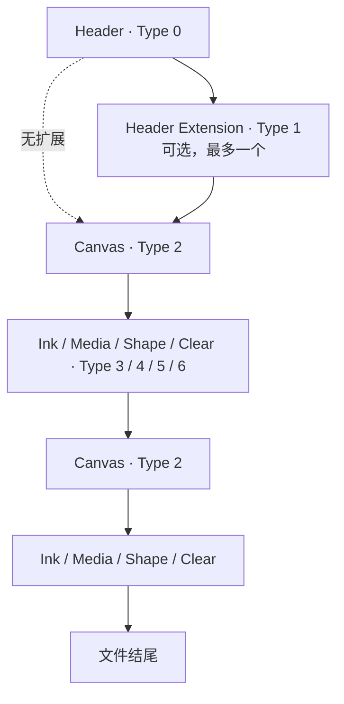

**主文件 `filename.uink` 是一串连续的 MessagePack 对象**：开头是 Header，然后是可选的 Header Extension，之后是一个个 Canvas，每个 Canvas 后面跟着它的内容块。读取器从头到尾读一遍，就能还原出所有页面。

::: tip 等级
- **核心级**：对象流结构、页面枚举、按页追加的读取规则、容错。
- **标准级**：多个 Workspace（屏幕批注、白板、PPT 同在一个文件）。
- **完整级**：多 Device、多图层、嵌套 Workspace 的合成。
:::

## 文件结构

<!-- visual: file-stream — 对象流：Header → Header Extension → Canvas → 内容块 → Canvas → 内容块 …… EOF；每个 Canvas 的作用域用括号标出 -->
<UInkFileStream />



- **FILE-1** 第一个块必须是 Header。
- **FILE-2** Header Extension 可选，最多一个；存在时必须紧跟 Header。
- **FILE-3** 内容块（Ink、Shape、Media、Clear）属于它前面最近的 Canvas；一个 Canvas 的作用域到下一个 Canvas 或文件结尾为止。
- **FILE-4** 第一个 Canvas 之前不得出现内容块。
- **FILE-5** Canvas 可以没有内容，用来表示空白页或空白图层。
- **FILE-6** 文件没有包裹所有对象的外层 Array；对象一个接一个直接排列。

## 页面从哪里来

一个文件可以同时装下多个白板、屏幕批注和 PPT。它们由两棵注册树描述，Canvas 再把两者连起来：

- **Workspace 树**（场景）：白板、PPT 等，各自维护一组页面，可以父子嵌套。
- **Device 树**（显示区域）：显示器（Display）与窗口（Window）。
- **Canvas**：某一页在某个 Device 上的某个图层，用 `workspaceGuid`、`deviceGuid`、`pageGuid`、`layerIndex` 定位。

注册表缺失时，读取器为它建立一个[隐式单例](../glossary#文件与结构)；Canvas 可以省略对应的 GUID。最简单的文件只有 Header 和若干 Canvas。

<!-- visual: registry-trees — 左边 Workspace 树（PPT ← 演示内白板），右边 Device 树（显示器 ← 板中板窗口），中间一排 Canvas 用连线分别指向两棵树 -->
<UInkRegistryTrees />

- **FILE-7** 页面由 Canvas 的 `pageGuid` 标识，在所属 Workspace 内按 `pageIndex` 排序；Canvas 在对象流中的位置不决定页序。
- **FILE-8** 同一个 [Canvas 唯一键](../glossary#页面与画布)在文件中出现多次时，后出现的 Canvas 连同它的全部内容块，整体替代先出现的那一个（[按页追加](../incremental#按页追加)）。被替代的 Canvas 与内容不再显示，也不参与编号。
- **FILE-9** 核心级读取器按以下方式列出页面：按 Workspace 注册顺序，逐个 Workspace 按 `pageIndex` 列出页面；每一页取第一个注册 Device 上的 Canvas（隐式单例时只有一个），该 Device 上没有这一页的 Canvas 时，按注册顺序取第一个有这一页 Canvas 的 Device；同一页的多个图层按 `layerIndex` 从小到大叠加显示。
- **FILE-10** 一页在某个 Device 上的显示视口始终铺满该 Device；`viewport` 决定视口对着 Canvas 的哪一块区域（见 [Canvas 块](../blocks/canvas#viewport)）。

### 合成顺序（完整级）

- **FILE-11** 同一页、同一 Device 内，`layerIndex` 越大越靠前。
- **FILE-12** 子 Workspace 合成在父 Workspace 之上；同级 Workspace 按注册顺序合成，后注册的在上。
- **FILE-13** Window Device 按 `zIndex` 合成，越大越靠前；相同时后注册的在上。

### 常见场景

| 场景 | 写法 |
| --- | --- |
| 一块白板，多页 | 一个 `workspaceType = 1` 的 Workspace；每页一个 Canvas |
| 一份 PPT 的批注 | 一个 `workspaceType = 2` 的 Workspace，`hostId` 标识演示文稿；每张幻灯片一个 Canvas，用 `slideId` 绑定 |
| 双屏同步翻页的白板 | 一个 Workspace；同一页在两个 Device 上各有一个 Canvas，共享 `pageGuid` 与 `pageIndex`，笔迹各自独立 |
| 双屏各自翻页 | 每块屏幕一个 Workspace |
| PPT 里打开的小白板 | 子 Workspace 用 `parentWorkspaceGuid` 指向 PPT Workspace，并引用一个 Window Device |
| 空白页 | 只写 Canvas，不跟内容块 |

## 内容顺序

- **FILE-14** 同一个 Canvas 中，Ink、Shape、Media、Clear 按对象流顺序处理，读取器不得按块类型重新排序。顺序决定绘制的先后，也决定 Erase 与 Clear 作用于哪些内容。
- **FILE-15** `contentId` 在每个 Canvas 内从 `0` 开始按对象流顺序连续编号；`undoId` 从 `0` 开始只增不减。详见 [Ink 块](../blocks/ink#编号与撤回)。

## 资源包

Media 引用的图片、PDF 等资源放在同名的 `filename.uink.extra` ZIP 中，见[资源包](extra)。资源包可以没有；主文件始终是内容的权威来源，资源缺失时笔迹与图形照常显示。

## 容错

先确定能读到哪里：

- **FILE-16** 文件结尾落在最后一个对象中间时，丢弃这个不完整的对象，保留之前所有完整的对象。
- **FILE-17** 非最后一个对象解码失败，或对象之间出现无法解码的字节时，保留失败位置之前的完整对象，停止读取余下字节；不得逐字节搜索下一个对象的开头。
- **FILE-18** 不认识的 Type ID：跳过这个完整对象，继续读取（TYPE-9）。
- **FILE-19** 能完整解码但字段无效的已知块：按该块页面的规则跳过或回退，继续读取。

再建立页面模型：

- **FILE-20** 不认识的 `workspaceType`：按普通白板加载，不执行宿主绑定。
- **FILE-21** 不认识的 `deviceType`：当作本次加载临时使用的根显示区域。
- **FILE-22** Workspace 或 Device 的父引用形成循环：断开造成循环的引用，把对应项当作临时根项。
- **FILE-23** Canvas 引用的 GUID 不存在：建立临时的 Workspace 或根 Device，并报告警告。
- **FILE-24** 以上临时结果只用于本次显示，不得自动写回源文件。

## 示例

两块显示器上的同一页 PPT：

```jsonc
[0, 11, "5fe30f46-be92-49b6-b921-a60706febf10", 2, 1, 1, 1700000000]
{
  "type": 1,
  "devices": [
    { "guid": "11111111-1111-4111-8111-111111111111", "deviceType": 0,
      "x": 0, "y": 0, "width": 3840, "height": 2160 },
    { "guid": "22222222-2222-4222-8222-222222222222", "deviceType": 0,
      "x": 3840, "y": 0, "width": 1920, "height": 1080 }
  ],
  "workspaces": [
    { "guid": "aaaaaaaa-aaaa-4aaa-8aaa-aaaaaaaaaaaa", "workspaceType": 2,
      "hostId": "INKEYS-PPT-7B58E2A1", "currentPageIndex": 0 }
  ]
}
{
  "type": 2,
  "workspaceGuid": "aaaaaaaa-aaaa-4aaa-8aaa-aaaaaaaaaaaa",
  "deviceGuid": "11111111-1111-4111-8111-111111111111",
  "pageGuid": "cccccccc-cccc-4ccc-8ccc-cccccccccccc",
  "pageIndex": 0, "pageNumber": 1, "layerIndex": 0, "layerNumber": 0,
  "slideId": 256
}
// 第一块屏幕上这一页的 Ink / Shape / Media
{
  "type": 2,
  "workspaceGuid": "aaaaaaaa-aaaa-4aaa-8aaa-aaaaaaaaaaaa",
  "deviceGuid": "22222222-2222-4222-8222-222222222222",
  "pageGuid": "cccccccc-cccc-4ccc-8ccc-cccccccccccc",
  "pageIndex": 0, "pageNumber": 1, "layerIndex": 0, "layerNumber": 0,
  "slideId": 256
}
// 第二块屏幕上这一页的内容，与第一块屏幕互相独立
```

## 相关

- [块类型与编码](../type)
- [保存、追加与恢复](../incremental)
- [资源包](extra)
- [Header Extension 块](../blocks/headerExtension)
- [Canvas 块](../blocks/canvas)
