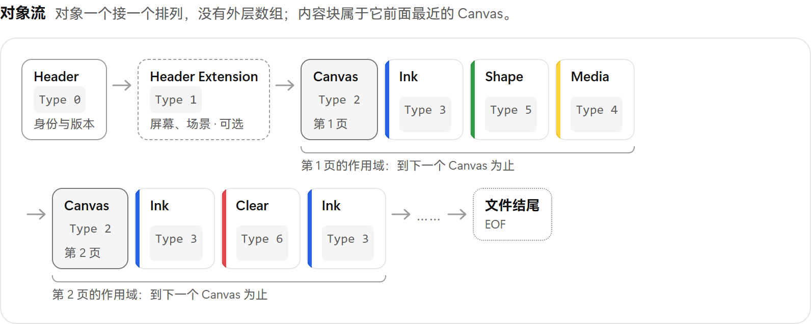
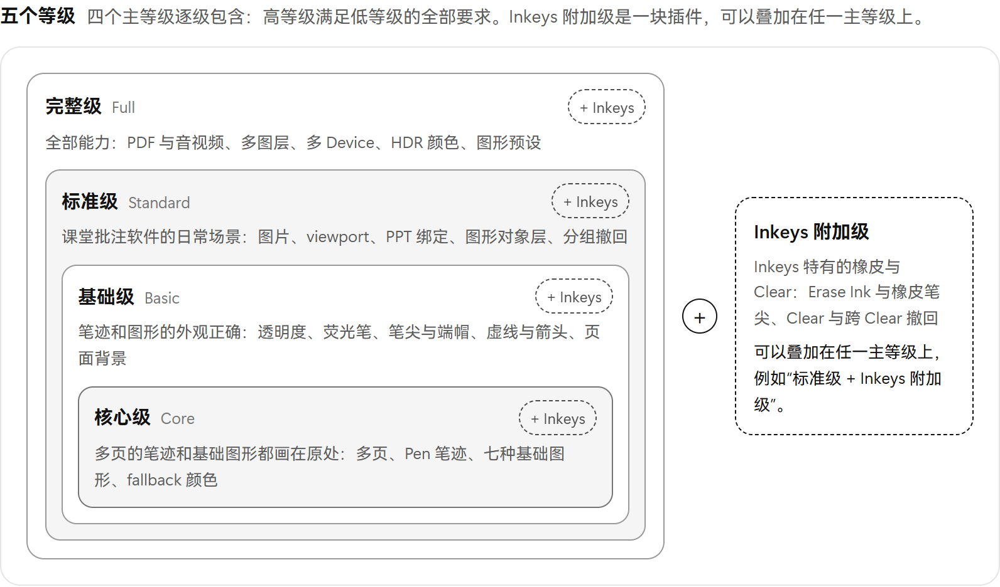
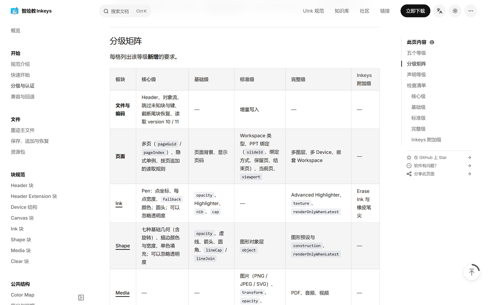
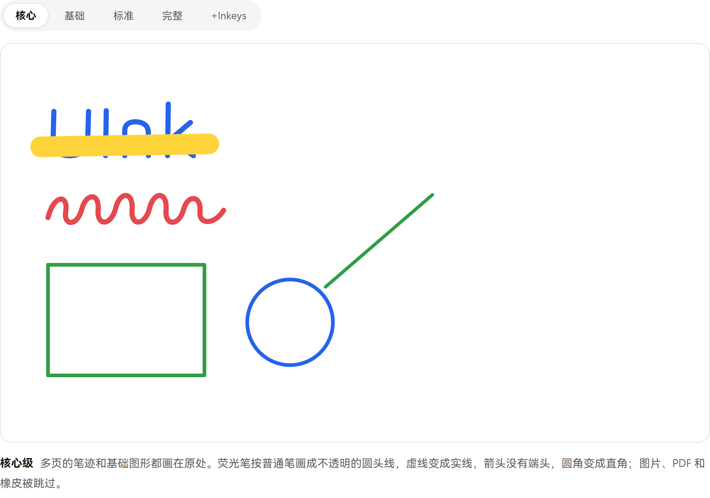
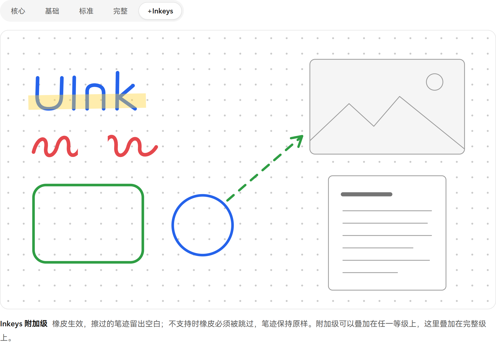
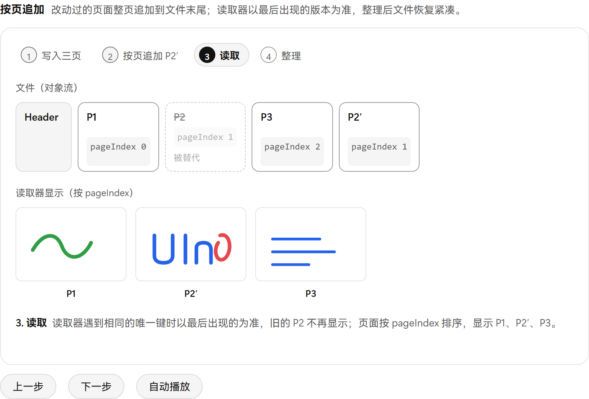
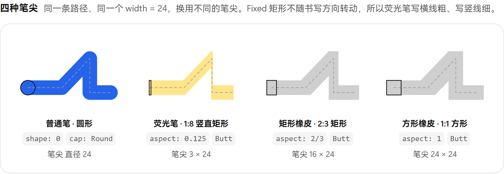
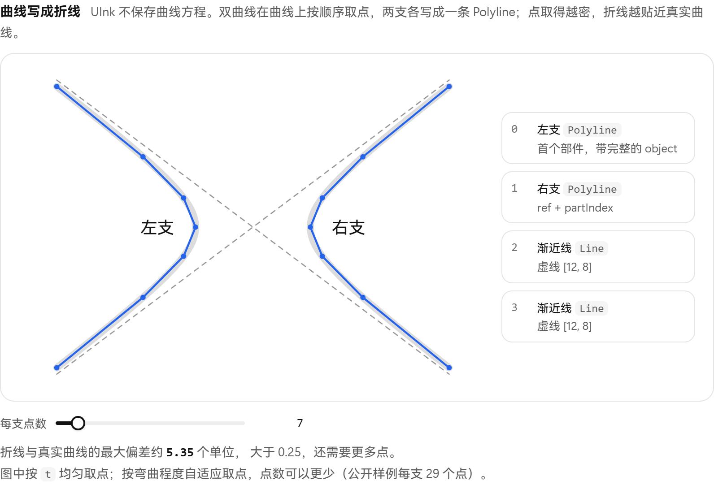
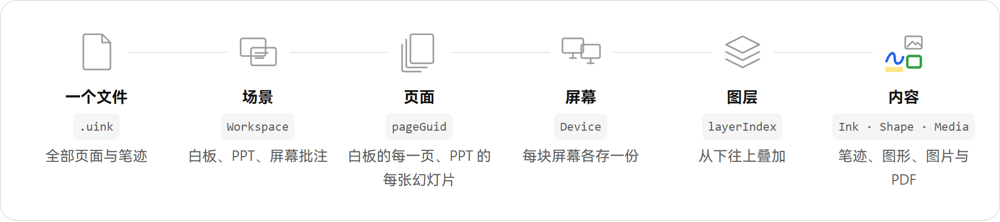

# UInk 1.1 发布：一份墨迹，处处可读

> 开放墨迹文件规范 UInk 迎来 1.1 Beta：引入五级功能分级、明确的兼容回退规则、按页追加保存，并配上全新改版的规范网站，还准备了给 AI 助手直接读的单文件规范与 `llms.txt`。


---

## 一、UInk 是什么

在白板上写了一节课的板书，在 PPT 上圈了二十几页重点，换一款软件打开，常常就对不上了：笔迹丢了、位置偏了，PPT 批注和幻灯片对不上号，甚至整个文件打不开。原因很简单，每款批注软件都用自己的私有格式保存墨迹。

**UInk 是一份开放的墨迹文件规范。** 一个 `.uink` 文件可以装下一整块白板、一整份 PPT 的全部批注：多页、多块屏幕、笔迹、图形、图片和 PDF 都在里面。不同的批注与白板软件按同一套规则读写，换一款软件打开，每一笔都还在原来的位置。

一份 UInk 墨迹由两个文件组成：

- **主文件** `lesson.uink`：一串连续的 [MessagePack](https://msgpack.org/) 对象，保存全部页面、笔迹、图形和媒体引用，内容以它为准。
- **资源包** `lesson.uink.extra`：一个 ZIP，存放图片、PDF、音视频等资源，可以没有。资源包缺失时，笔迹和图形照常显示。

主文件里，对象一个接一个排列：开头是表明身份和版本的 Header，接着是一页一页的 Canvas，每页后面跟着它的笔迹（Ink）、图形（Shape）、媒体（Media）等内容块。



目前 [智绘教Inkeys](https://www.inkeys.top/) 和 [ICC-CE](https://github.com/InkCanvasForClass/community)（InkCanvasForClass 社区版）都在使用 UInk。

---

## 二、UInk 1.1 带来了什么

UInk 1.0 Beta 发布以后，我们收集了 Inkeys 和 ICC-CE 两款软件在实际读写中遇到的问题，比如：不同软件支持的功能差别很大，怎样才算“支持 UInk”？低版本软件遇到看不懂的内容，该显示成什么样？白板翻一页就要重写整个文件，能不能更快？1.1 主要回答的就是这些问题。

### 1. 五级功能分级：先做到能用，再逐步做全

这是 1.1 最大的变化。UInk 把全部功能分成四个主等级和一个附加等级：

| 等级 | 一句话 | 典型实现 |
| --- | --- | --- |
| **核心级** | 多页的笔迹和基础图形都画在原处 | 任何支持多页与矢量的绘图软件、文件预览器 |
| **基础级** | 笔迹和图形的外观正确 | 笔记、白板类软件 |
| **标准级** | 课堂批注软件的日常场景 | ICC-CE、智绘教Inkeys |
| **完整级** | 全部能力 | 规范参考实现 |
| **Inkeys 附加级** | Inkeys 特有的橡皮与清空 | 智绘教Inkeys |



高等级包含低等级的全部要求；Inkeys 附加级像一块插件，可以叠加在任一主等级上，比如“标准级 + Inkeys 附加级”。

分级带来的最大好处是**降低门槛**。核心级刻意定得很小：读懂 Header、按页列出内容、按点坐标和每点宽度画出笔迹、画出七种基础图形，就能正确显示任何 UInk 文件的主要内容。一个文件预览器、一个小工具，花不了多少工夫就能接入 UInk 生态；想做得更完整，再按清单逐级往上加。

等级不写进文件。文件可以自由组合任何功能，等级只是给实现者的对接参考：读取和写入分别声明，例如

```text
UInk 1.1 读取：标准级 + Inkeys 附加级；写入：基础级
```

网站上的“分级与认证”页面给出了完整的分级矩阵和每一级的检查清单，每一条都标注了对应的规则编号。



### 2. 兼容与回退：看不懂的内容，也有确定的显示方式

功能分了级，就必然会出现“低等级软件打开高等级文件”的情况。1.1 为每一项高级能力都写明了**不支持时怎么显示**：荧光笔按普通笔画，虚线变实线，圆角变直角，不认识的图片位置留空……核心内容始终正常显示，不会因此打不开整个文件。

同一页板书，在核心级读取器里是这样：



在完整级加 Inkeys 附加级的读取器里是这样：



两边的画面不同，但每一笔都在原处。

反方向也考虑到了：写入器可以导出“目标等级兼容版”。比如智绘教Inkeys 的高级橡皮，导出给不支持它的软件时，会把擦除结果直接烘焙进笔画几何，被擦到的笔迹切成剩下的片段。对方软件不需要理解橡皮，也能看到一样的画面。

此外还有几条保护规则：回退只影响本次显示，不会自动写回源文件；文件里有读取器不支持的内容时，保存默认是“另存为”，避免一不小心把别人的内容存丢。

### 3. 按页追加：白板翻页、PPT 换页不再重写整个文件

1.0 只能在文件末尾的最后一页继续追加内容。1.1 新增**按页追加**：任意一页改动后，把这一页的完整新版本追加到文件末尾即可，读取器遇到同一页出现多次时，以最后出现的为准。



对几十页的白板和 PPT 批注来说，这意味着保存更快，崩溃时也最多丢掉最后一个没写完的对象。被替代的旧版本会在合适的时候“整理”掉，重新变回紧凑文件。

### 4. 页面元数据官方化：背景、PPT 绑定都有了正式字段

1.0 时代，白板背景、PPT 页码绑定这些信息只能各家软件塞进私有字段。1.1 把它们收进了 Canvas：

- **页面背景** `background`：纯色加空白、点阵、网格等图案。
- **PPT 绑定**：按 `slideId` 绑定幻灯片，或按页序绑定；批注跟着幻灯片走，幻灯片顺序调整也不会错位。
- **保留页**：PPT 中对应幻灯片已被删除，批注仍然保存，不在正常页序中显示，可以重新绑定。
- **结束页**：PPT 放映结束后黑屏页上的批注。
- **视口** `viewport`：白板的平移和缩放。

### 5. 笔尖与端帽：荧光笔、方形橡皮都能准确描述

1.1 新增笔尖描述 `nib`：圆形还是矩形、宽高比、是否随书写方向转动。荧光笔常用的竖直细矩形笔尖、矩形橡皮、方形橡皮，都能原样记录下来。笔尖尺寸也尽量直观：圆形笔尖的 `width` 就是直径，矩形笔尖的 `width` 就是高度。



同时新增了 Ink 的端帽 `cap`，以及图形描边的 `lineCap` 和 `lineJoin`。

### 6. 图形对象层：复杂图形可以整体编辑

坐标轴、圆锥曲线、立体图形这类复杂图形，往往由多个部件组成。1.1 新增**图形对象层**：一组部件可以标记成同一个图形对象，在支持的软件里整体选中、整体编辑；不支持的软件就把每个部件当作普通图形显示，画面不受影响。完整级还提供了图形预设注册表，记录图形的构造参数。

曲线的写法也统一了：UInk 不保存曲线方程，曲线按顺序采样成折线或多边形，断开的部分分别写。这样任何读取器只要会连线，就能画出曲线。



### 7. 其他改进

- **图片的适配与裁剪**：Media 新增 `fit`（拉伸、完整放入、铺满裁切、原始大小）和 `crop`。
- **坐标单位更明确**：画布坐标统一使用屏幕的实际像素，缩放交给 `viewport` 表达，不同 DPI 的设备之间不再有歧义。
- **版本规则更宽容**：版本号 = 主版本 × 10 + 次版本。读取器遇到同一主版本、更高次版本的文件时，会跳过不认识的内容，尽力读取其余部分；1.0 读取器经勘误后也能读出 1.1 文件中兼容的部分。

完整的变化清单见网站上的“版本与变更”页面。

### 8. 全新的规范网站

规范写得再好，看不懂也没用。这次我们把整套 UInk 文档从头重写了一遍，规范网站也一起改版。

**更好懂的文字。** 全部页面用平实的语言重写：先说清楚“这是什么、为什么”，再给字段和规则。每条规范性规则都有稳定的编号（比如 `INK-11`、`SAVE-10`），检查清单、回退表、样例说明都按编号互相引用，实现和排查问题时可以精确定位。

**能看、能点的图示。** 文件结构、笔尖、曲线、视口、按页追加……几乎每个概念都配了图，其中一些还能交互：在主页上点不同的等级，可以直接看同一页板书在不同读取器里的样子；按页追加的图示可以一步步播放。



**一个专门的 UInk 主页。** 首屏一句话讲清楚 UInk 是什么，往下分别展示“通用”和“集合”两个特点，最后告诉开发者怎样三步写出一个最小读取器。

**给 AI 助手准备的版本。** 现在很多开发者会让 AI 编程助手帮忙写代码。为此，网站构建时会把全部规范页面自动拼成**一个 Markdown 文件**，同时提供一份 [llms.txt](https://www.inkeys.top/standard/llms.txt) 索引（[llmstxt.org](https://llmstxt.org/) 格式）。把它们交给 AI 助手，它就能一次读完整份规范，不用一页页去爬网页。


`llms.txt` 的开头大致是这样：

```markdown
# UInk

> UInk 是开放的墨迹文件规范：一个 `.uink` 文件保存一个白板或一份 PPT 的全部页面、笔迹、图形与媒体，供不同的批注与白板软件互相读写。

当前版本为 UInk 1.1 Beta（`Header.version = 11`）。实现读取器或写入器时，优先阅读单文件版规范。

## 规范

- [UInk 1.1 规范（单文件版）](https://www.inkeys.top/dist-standard/uink-v11/spec.md): 全部规范页面按目录顺序拼成的单个 Markdown 文件
- [UInk 规范](https://www.inkeys.top/standard/intro)
- [快速开始](https://www.inkeys.top/standard/quick-start)
- [分级与认证](https://www.inkeys.top/standard/levels)
- ……
```

**16 个公开样例。** 1.1 提供了 16 个样例文件，覆盖每个等级和各种边界情况：多页与基础图形、按页追加、荧光笔与虚线、PPT 绑定、图片裁剪、多图层多屏幕、HDR 颜色、Inkeys 橡皮与清空，还有文件结尾被截断、中间损坏、来自未来版本等异常文件。配套的 `fixtures.json` 写明了每个样例在各等级下应该显示成什么样，实现者可以逐个对照验证。

---

## 三、UInk 的特点

### 通用：同一个文件，在不同软件里打开

UInk 的出发点就是互通。功能分级保证了“下限”：哪怕只实现核心级，也能正确显示任何 UInk 文件的主要内容。兼容回退规则保证了“过渡”：遇到自己不支持的内容，有明确的显示方式，而不是报错或乱画。

UInk 也不追求像素级一致。曲线插值、抗锯齿、箭头的外形可以因软件而不同，但**点的位置、宽度、颜色和顺序必须一致**。这样既保证了内容和布局可靠，又给各家软件的渲染留出了空间。

### 集合：一块白板，一个文件

一块白板的所有页面、一份 PPT 每张幻灯片上的批注，都保存在同一个 `.uink` 里。一个文件还可以同时包含屏幕批注、白板、PPT 等多个场景，以及多块屏幕、多个图层。分享一节课的板书，只需要发一个文件，PPT 批注也不会和幻灯片走散。

### 快速保存，不怕崩溃

UInk 的主文件是一串连续的对象，没有外层包裹。书写时可以每抬一次笔就把这一笔追加到文件末尾；翻页时可以只追加改动的那一页。软件意外崩溃时，最多丢掉最后一个没写完的对象，之前的内容全部保留。完整保存则先写临时文件，确认无误后再整体替换，不会把原文件写坏。

### 未知内容可以跳过

新版本增加的块和字段，旧软件可以直接跳过，其余内容照常显示。软件自己的私有数据可以放进专门的 `extra` 字段，不会干扰其他软件。这让 UInk 可以持续演进，又不会让旧软件突然打不开新文件。

### 简单而克制

UInk 只保存“现在是什么样”，以及撤回所需的分组信息，不保存重做和完整的编辑历史；曲线一律写成采样点；颜色始终带一个 sRGB 的 `fallback`，HDR 只是锦上添花。很多设计都在刻意做减法，目的只有一个：让更多软件能以更低的成本正确实现它。

### 开放

UInk 规范全文公开在网站上，规则、样例和期望结果都摆在明处。任何批注、白板或笔记软件都可以按规范实现读写，加入同一个墨迹生态。

---

## 四、现状与下一步

UInk 1.1 目前是 **Beta** 版（`Header.version = 11`）。智绘教Inkeys 与 ICC-CE 正在适配 1.1；两款软件完成适配、公开样例完成互通验证后，1.1 将冻结为正式版。Beta 期间规范仍可能修正，如果你在阅读或实现时发现问题，欢迎反馈。

- 规范主页：<https://www.inkeys.top/standard/>
- 版本与变更：<https://www.inkeys.top/standard/version>
- 单文件规范：<https://www.inkeys.top/dist-standard/uink-v11/spec.md>
- llms.txt：<https://www.inkeys.top/standard/llms.txt>
- 公开样例：<https://www.inkeys.top/dist-standard/uink-v11/fixtures.json>

如果你也在开发批注、白板或笔记类软件，欢迎来看看 UInk。一份墨迹，处处可读。
